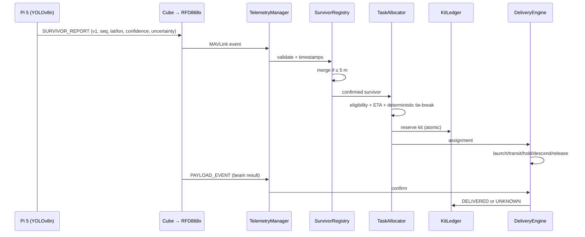

# RescueSwarm GCS — Phase A/B Audit, Architecture and Implementation Plan

**Project:** RescueSwarm — NIDAR 2026–27, Problem Statement 1  
**Team:** ADRODS-X  
**Document date:** 30 October 2026  
**Baseline:** three-aircraft fleet — INS-01 (search), DEL-01 and DEL-02 (delivery), 10 pooled 200 g kits  
**Status labels used throughout:** DESIGNED, CALCULATED, ASSUMED, BUILT-SIMULATED, PHYSICALLY TESTED, PENDING TEST.

---

## 1. Repository audit

### 1.1 What exists in the new workspace

The session workspace (`2026-10-30/90bca111`) was **empty**. There was no repository to preserve, no `package.json`, no backend, no tests.

An earlier prototype was located outside the workspace at `C:/Users/nithy/Desktop/NIDAR/gcs-app` and audited read-only. It is a previous-generation build and is **not modified** by this work.

### 1.2 Audit of the earlier prototype

| Area | Observed state | Assessment |
|---|---|---|
| UI shell | Electron 30 + React 18 + Vite + Tailwind; ~1,150 source lines in 4 Python and 15 React files | Usable visual reference only. The layout is a single always-on dashboard with no setup workflow. |
| Backend | 4 Python files; JSON over stdin/stdout to Electron | Not an API. No REST, no WebSocket, no service isolation, no crash supervision, no tests. |
| Telemetry | One serial port, one MAVLink parser | Cannot represent three independent vehicles; no identity validation, stale detection, ACK tracking, mission upload or geofence support. |
| Allocation | Nearest-distance allocator with two hard-coded drone positions | No eligibility filter, no queue-aware ETA, no battery/link/failsafe gate, no deterministic tie-break, no reservation ledger. |
| Survivors | Frontend-only simulated detections | No registry, no duplicate rule, no provenance, no persistence. |
| Video | Synthetic canvas/stream inside the renderer; YOLO boxes drawn over the operator feed | Violates the Pi Camera 3 Wide / RunCam Nano 2 distinction. No real capture, mapping, health or recording. |
| Map | Tactical grid component | Not MapLibre, no KML, no offline basemap, no lanes or geofence. |
| Persistence | None | No SQLite, no mission folder, no replay, no reports. |
| Configuration | Hard-coded 25 m search altitude, 915 MHz radio, one DEL payload | Contradicts the current 12 m / 868 MHz / three-aircraft baseline. |
| Test coverage | None | No pytest, no Playwright, no SITL integration. |

**Verdict:** the prototype is `BUILT-SIMULATED` on an obsolete configuration. It cannot be upgraded safely in place; its UI patterns are worth reusing, its architecture is not.

### 1.3 What this build does

A new, modular implementation in `rescueswarm-gcs/`:

- Python/FastAPI backend that owns serial, MAVLink, planning, safety, persistence and video.
- SQLite mission database and per-mission evidence folder.
- Three-vehicle MAVLink discovery with identity validation and a transport abstraction for one shared or three independent radios.
- Deterministic simulation mode for the complete mission, clearly watermarked and separated from REAL mode.
- React/TypeScript/MapLibre operator interface with the full setup-to-flight workflow.
- Electron shell with context isolation, sandboxing and a strict CSP.
- pytest suite covering planning, safety, allocation, ledger, delivery and simulation.

No simulated result is presented as flight-proven. Real-mode capabilities that cannot be verified on the current bench are labelled `PENDING TEST`.

---

## 2. Current-fleet reconciliation

| Conflict in supplied material | Resolution in this build |
|---|---|
| `06_...` describes HYB-01/HYB-02; `08_...` describes INS-01/DEL-01/DEL-02 | The three-aircraft fleet is the only fleet profile. The old file is archived in `docs/reference/` and not used for code or UI. |
| 25 m search altitude in the old prototype | 12 m AGL baseline, configurable and labelled DESIGNED. |
| 915 MHz in the old README | RFD868x, Indian regional configuration **unverified**. |
| AI camera vs operator camera | YOLO detections appear on the map/registry only; no bounding boxes are painted on RunCam video. |
| One ground modem assumed to serve three aircraft | Not assumed. Transport abstraction supports one shared multipoint link or three point-to-point links; the topology must be commissioned. |
| 4,678 m / 10.15 min search figure | The planner recomputes geometry from the imported KML; the published 500 × 200 m figures remain a comparison case. |
| 14–15 min mission target | Shown as a planning estimate with all inputs exposed, never as achieved performance. |

---

## 3. Requirement traceability

Legend: **✅ implemented and tested in simulation**, **◐ implemented, physical validation pending**, **○ interface/abstraction present, hardware decision open**.

| Requirement group | Implementation | Status |
|---|---|---|
| 1. Desktop startup and splash | Electron shell + branded splash, version, offline badge, SIM/REAL selection | ✅ |
| 2. System initialisation | Health checks for backend, DB, storage, map, video, USB, modem | ✅ |
| 3. Hardware device manager | Serial and capture enumeration, stable fingerprints, rescan | ◐ |
| 4. RFD868x telemetry manager | MAVLink transport abstraction, heartbeat, link diagnostics, reconnect | ◐ |
| 5. Three-drone identity manager | SYSID/type/role validation, duplicate and unexpected-ID blocking | ✅ |
| 6. TX800 video manager | Three independent feeds, mapping, health, recording, MJPEG | ◐ |
| 7. KML import and validation | Offline parser, Shapely validity, area, projection, hashing | ✅ |
| 8. Offline tactical map | MapLibre with local procedural tiles + GeoJSON layers; no web tiles | ✅ |
| 9. Automatic mission planner | Long-axis lawnmower lanes, insets, turn-aware timing | ✅ |
| 10. Geofence generation/verification | Inclusion polygon + altitude per aircraft, upload/readback state | ◐ |
| 11. Hardware inspection manager | Role-specific automated and manual checks with evidence source | ✅ |
| 12. Automatic preflight diagnostics | PASS / FAIL / WARNING / MANUAL / UNKNOWN report | ✅ |
| 13. Mission upload and readback | Simulated verified upload; MAVLink mission protocol adapter for real mode | ◐ |
| 14. Mission readiness gate | Backend-evaluated hard gate, start lock | ✅ |
| 15. Fleet monitoring | Per-vehicle state, staleness, battery, EKF, link, separation | ✅ |
| 16. Survivor registry | Lifecycle, source timestamps, uncertainty, observations | ✅ |
| 17. Geotag management | Position + uncertainty ring, boundary-adjusted drop point | ✅ |
| 18. Duplicate detection | 5 m deterministic merge, logged | ✅ |
| 19. AI mission intelligence | Local rules-based copilot; optional local Ollama adapter; no control authority | ✅ |
| 20. ETA allocation | Eligibility filter, queue-aware ETA, deterministic tie-break, full audit | ✅ |
| 21. Shared kit ledger | 10 kits, transactional reservation, UNKNOWN handling, no double release | ✅ |
| 22. Delivery state machine | Queue → launch → transit → hold → descend → verify → release → confirm | ✅ |
| 23. Fleet safety manager | Clearance, separation, pad, boundary, battery, recall | ✅ |
| 24. Three-channel video dashboard | Three simultaneous panels + HUD + health + recording | ✅ |
| 25. Event logging and audit | SQLite + JSONL, operator actions, commands, safety, telemetry | ✅ |
| 26. Mission replay | Telemetry-based track reconstruction and event scrubber | ✅ |
| 27. Mission analytics | Time, coverage, allocation, delivery, evidence-labelled | ✅ |
| 28. Automated report generation | JSON, CSV, HTML and dependency-free PDF | ✅ |
| 29. Local configuration manager | Versioned fleet/threshold profile, persisted settings | ✅ |
| 30. Optional offline AI copilot | Local summary/Q&A; LLM optional and non-authoritative | ✅ |

P0 acceptance detail is in `docs/REQUIREMENTS_TRACEABILITY.md`.

---

## 4. Architecture

### 4.1 System context

```mermaid
flowchart LR
  subgraph AIR[Aircraft]
    INS[INS-01<br/>Cube + Pi5/Hailo + Pi Cam 3W<br/>RunCam + TX800]
    D1[DEL-01<br/>Cube + TFmini-S + 5 kits]
    D2[DEL-02<br/>Cube + TFmini-S + 5 kits]
  end
  subgraph RF[Telemetry / command]
    GND[RFD868x ground modem(s)]
  end
  subgraph VID[Analog video]
    RXA[RX A + capture A]
    RXB[RX B + capture B]
    RXC[RX C + capture C]
  end
  subgraph APP[Offline Windows GCS]
    TM[TelemetryManager]
    VM[VideoManager]
    ME[MissionEngine]
    SE[SafetyEngine]
    DB[(SQLite + mission files)]
    API[FastAPI REST + WS]
    UI[Electron + React + MapLibre]
  end
  INS <-->|MAVLink 2| GND
  D1 <-->|MAVLink 2| GND
  D2 <-->|MAVLink 2| GND
  GND <--> TM
  INS -. 5.8 GHz .-> RXA
  D1 -. 5.8 GHz .-> RXB
  D2 -. 5.8 GHz .-> RXC
  RXA --> VM
  RXB --> VM
  RXC --> VM
  TM --> ME
  ME <--> SE
  VM --> API
  TM --> API
  ME --> DB
  SE --> DB
  DB <--> API
  API <--> UI
```

The radio topology is a **configuration choice**, never an assumption: `shared` (one verified multipoint ground modem) or `independent` (three point-to-point ground modems on separate ports).

### 4.2 Service boundaries

| Service | Owns | Must never do |
|---|---|---|
| `TelemetryManager` | Links, heartbeats, per-vehicle cache, ACK transactions | Invent telemetry; command actuators directly |
| `DeviceManager` | Serial/capture enumeration and fingerprints | Arm or command aircraft |
| `MissionPlanner` | KML, projection, lanes, fences, estimates | Upload invalid geometry |
| `MissionEngine` | Phase machine, plan, upload, authorization, run | Bypass safety |
| `SafetyEngine` | Interlocks, clearance, separation, pad, battery, recall | Depend on UI availability |
| `SurvivorRegistry` | Validation, merge, lifecycle | Overwrite measured uncertainty |
| `TaskAllocator` | Eligibility, ETA, tie-break, reservation | Fire payloads |
| `KitLedger` | Transactional kit states | Mark DELIVERED without beam evidence |
| `DeliveryEngine` | Per-assignment state machine | Re-fire an UNKNOWN release |
| `VideoManager` | Capture, mapping, health, recording, streams | Own flight state |
| `Copilot` | Local explanation and summarisation | Execute commands or clear interlocks |
| `ReportService` | Evidence exports | Blend estimates with measurements |
| `Database` | Durable mission evidence | Store video blobs inside SQLite |

### 4.3 Data flow — detection to delivery



### 4.4 Mission state machine

```text
APP_START → SYSTEM_INIT → DEVICE_DISCOVERY → FLEET_DISCOVERY
→ KML_IMPORT → PLAN_GENERATION → HARDWARE_DIAGNOSTICS → PREFLIGHT
→ MISSION_UPLOAD → READBACK_VERIFY → READY_FOR_AUTHORIZATION
→ MISSION_ACTIVE → SEARCH_AND_DELIVERY → RECOVERY → POST_MISSION

Any active phase → EMERGENCY_RECOVERY → POST_MISSION
```

### 4.5 Delivery state machine

```text
QUEUED → LAUNCHING → TRANSIT → HOLD_CLEARANCE → DESCENT
→ HOVER_VERIFY → RELEASE_SENT → CONFIRMED | UNKNOWN
→ CLIMB → (next target | RETURNING → LANDING → STANDBY)

UNKNOWN is terminal for that kit: no automatic re-fire.
```

### 4.6 Database schema (SQLite)

`missions`, `telemetry_samples`, `connection_events`, `preflight_checks`, `operator_actions`, `mission_plans`, `survivors`, `survivor_observations`, `assignments`, `kits`, `payload_events`, `safety_events`, `video_sessions`, `mission_events`, `settings`.  
Full DDL is in `backend/rescueswarm/db.py`; the entity specification is in `docs/ARCHITECTURE.md`.

### 4.7 API surface

REST under `/api`: `system/*`, `devices`, `fleet`, `mission/*`, `planner/*`, `preflight/*`, `survivors`, `allocations`, `kits`, `video/*`, `events`, `replay/*`, `reports/*`, `copilot/*`, `emergency/*`, `settings`, `sim/*`.  
WebSocket `/ws` streams versioned events (`fleet.telemetry`, `mission.phase`, `survivor.created`, `allocation.created`, `payload.result`, `video.health`, `safety.interlock`, `operator.action`).  
Full contract in `docs/API.md`.

### 4.8 MAVLink mapping

| Purpose | Message | Handling |
|---|---|---|
| Presence | `HEARTBEAT` | 1 Hz per vehicle; staleness at 3 s |
| Position | `GLOBAL_POSITION_INT` | lat/lon/alt/relative alt/velocity/heading |
| GPS | `GPS_RAW_INT` | fix type, satellites, eph |
| Attitude | `ATTITUDE` | roll/pitch/yaw |
| Battery | `SYS_STATUS`, `BATTERY_STATUS` | voltage, remaining |
| EKF | `EKF_STATUS_REPORT` | flags + variance |
| Rangefinder | `DISTANCE_SENSOR` | delivery altitude |
| Pre-arm/warnings | `STATUSTEXT` | raw text retained |
| Commands | `COMMAND_LONG` + `COMMAND_ACK` | transaction + timeout + retry |
| Mission | `MISSION_COUNT/REQUEST/ITEM_INT/ACK` | plan type 0 mission, 1 fence |
| Events | `TUNNEL` v1 schema (or custom dialect) | bounded JSON, sequence, timestamp |

### 4.9 Folder structure

```text
rescueswarm-gcs/
  backend/
    rescueswarm/       config, db, geospatial, kml, planner, safety,
                       allocation, ledger, survivors, delivery, video,
                       map_tiles, simulation, mavlink, telemetry, api,
                       reporting, copilot, replay, mission_engine
    tests/
  desktop/
    src/               React app (views, components, stores, lib)
    electron/          main + preload
  config/              fleet + thresholds profiles
  samples/             sample KML and SIM ground truth
  docs/                audit, architecture, API, MAVLink, guides
  Missions/            created at runtime (not committed)
```

---

## 5. Technical risks and decisions

| ID | Risk / open decision | Mitigation in this build |
|---|---|---|
| R-01 | Four-node RFD868x topology unverified | `shared` vs `independent` transport modes; readiness fails if topology is unverified; no automatic pairing claim |
| R-02 | Ground video receivers/capture hardware not selected | Capture adapter by device fingerprint; UNMAPPED state until commissioned; three independent pipelines |
| R-03 | TX800 channels/power/legal approval unresolved | Channel plan is configuration, not code; radio commissioning gate |
| R-04 | AI camera ≠ operator camera | Detections rendered on map/registry only |
| R-05 | 3 m drop / 20 m clearance unproven | Safety engine enforces configured values, denies on stale data; documented as DESIGNED and PENDING TEST |
| R-06 | Break-beam can miss a successful release | `KIT_UNKNOWN`, no auto-retry; operator-led recovery only |
| R-07 | Physical kit inventory unproven by beam | Manual inventory sign-off required; ledger starts from signed counts |
| R-08 | Mission upload not atomic on ArduPilot | Item-by-item readback; mismatch fails readiness; save plan hash |
| R-09 | Search/battery estimates unverified | Inputs and provenance exposed; never shown as measured |
| R-10 | Windows USB enumeration changes | Stable fingerprints + preflight visual identity confirmation; adapter isolation |
| R-11 | 14–15 min target not flight-validated | Labelled CALCULATED/ASSUMED; measured vs estimated report column |
| R-12 | Offline basemap licensing/provisioning | Procedural local reference by default; no web tiles; optional locally provisioned tiles documented |
| R-13 | LLM could become a control path | Copilot is read-only; typed API; deterministic safety authority |
| R-14 | GCS crash could interrupt coordination | Onboard failsafes remain; mission/kit state persisted; replay/recovery documented |
| R-15 | Compliance / radio licensing | Documented as unresolved; no legal claim |

---

## 6. Phased implementation plan

| Phase | Scope | Exit criterion |
|---|---|---|
| A — Audit | Existing prototype, spec reconciliation, traceability | This document |
| B — Design | Architecture, schema, API, MAVLink, state machines | This document + API/architecture docs |
| C — UI foundation | Tokens, splash, navigation, status system, setup wizard | All setup screens render and navigate |
| D — Communication | Transport abstraction, discovery, identity, ACK, video mapping | Simulated 3/3 fleet; serial/UDP adapters tested for parse |
| E — Mission system | KML, planner, geofence, preflight, upload/readback, readiness | Valid plan and correct blocked-start reasons |
| F — Autonomy | Survivor registry, allocator, ledger, delivery, recovery | 10-survivor simulated mission fully auditable |
| G — Analytics/AI | Reports, replay, analytics, local copilot | Report and replay produced from mission evidence |
| H — Validation | Unit/integration/offline/build tests | Actual test output recorded in `docs/TEST_REPORT.md` |

This implementation follows C→H in this order: backend services first (so the UI binds to real APIs), then the operator interface, then packaging and verification.
