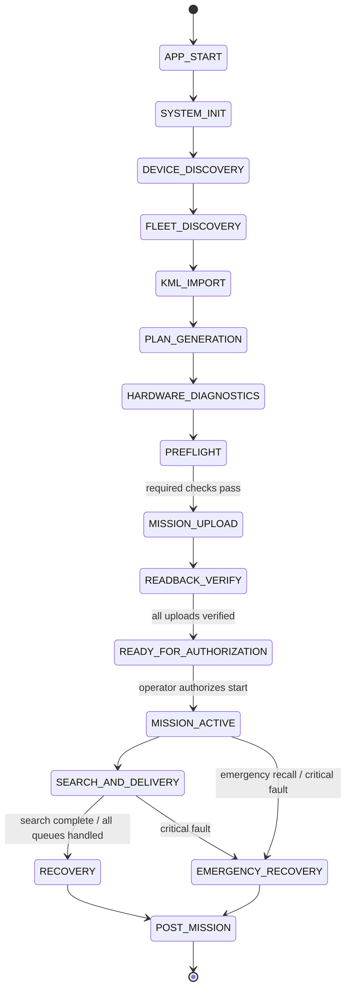
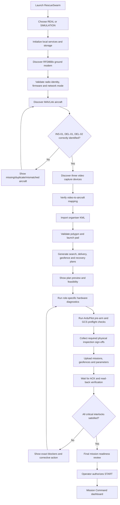
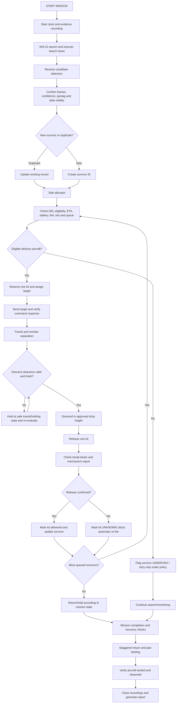

# RESCUESWARM GROUND CONTROL STATION
## Master Product Requirements, Technical Requirements, System Architecture, Workflow and UI/UX Specification

**Project:** RescueSwarm – NIDAR 2026–27, Problem Statement 1  
**Team:** ADRODS-X  
**Document type:** Master GCS product and engineering specification  
**Version:** 1.0 – Research Consolidation Draft  
**Date:** 30 October 2026  
**Target platform:** Windows desktop, fully offline during mission operations  
**Fleet:** INS-01 search quadcopter + DEL-01 and DEL-02 delivery hexacopters  
**Design direction:** DJI-inspired operational clarity + Apple/iOS-inspired visual refinement; original RescueSwarm identity, not a clone of either product

---

## Document status and how to read this report

This report combines the team's uploaded NIDAR architecture documents with external research from primary technical documentation. It is a design and engineering specification, not a flight approval, regulatory opinion, or proof that the system has passed testing.

The following evidence labels are used throughout:

| Label | Meaning |
|---|---|
| **SOURCE DESIGN** | Described in the team's uploaded architecture documents. |
| **RESEARCH VERIFIED** | Supported by an external manufacturer's or protocol/software maintainer's documentation. |
| **PROPOSED** | A recommended product or software requirement that the team should adopt. |
| **ASSUMPTION** | A design input that has not yet been validated. |
| **PENDING TEST** | Requires bench, SITL, hardware-in-loop, field, or compliance verification. |
| **NOT IN SCOPE** | Deliberately excluded from the initial GCS release. |

### Important engineering boundary

The GCS must not present an estimated, simulated, stale, or unavailable value as live verified data. Simulation, calculated mission estimates, hardware telemetry, physical inspection sign-offs and confirmed flight-test results must remain visibly distinct in the UI and in exported reports.

---

# 1. Executive summary

RescueSwarm GCS is a Windows desktop command-and-monitoring application for one operator supervising three autonomous aircraft in an offline disaster-search-and-medical-delivery mission.

The GCS receives information through **two independent RF systems**:

1. **Telemetry and command network:** RFD868x radio modem(s), connected to the GCS by USB/serial, carrying MAVLink 2 data between the GCS and the three Cube Orange+ flight controllers.
2. **Live video network:** three independent 5.8 GHz analog video links. Each aircraft carries one SpeedyBee TX800 VTX and camera; the ground station needs three compatible 5.8 GHz receivers and three video capture inputs (or an equivalent validated multichannel receiver/capture system).

These are separate networks. The RFD868x link carries flight telemetry, commands, acknowledgements and mission events. The TX800 links carry camera video. The video path is not a flight-control or telemetry path.

The GCS should provide:

- Automatic local hardware discovery and initialization.
- Discovery and identity verification of INS-01, DEL-01 and DEL-02.
- A KML import and validation wizard.
- Automatic search-path, geofence and delivery mission planning.
- Role-specific aircraft diagnostics and pre-flight inspections.
- Mission upload, acknowledgement tracking and read-back validation.
- A hard mission-readiness gate before launch authorization.
- A real-time three-drone command dashboard and offline tactical map.
- Three simultaneous, independently monitored and recorded video feeds.
- Survivor registration, geotag display, duplicate handling and delivery allocation.
- Payload inventory and per-kit release verification.
- Fleet separation, pad interlock, link-loss and other safety monitoring.
- Automatic mission logging, replay and post-mission reporting.

The recommended product experience is a **guided mission-preparation workflow followed by a single operational command dashboard**. The interface should be professional, calm, information-dense and easy to scan, drawing inspiration from DJI Pilot 2's operational workflow and Apple's hierarchy, spacing and panel design. It should not imitate either product's exact screens or branding.

## 1.1 Product statement

> RescueSwarm GCS turns three separately instrumented autonomous aircraft into one coordinated rescue operation: it plans from the organiser's KML, verifies the aircraft and ground equipment, tracks survivors, allocates kits, monitors delivery and records evidence — all without internet access during the mission.

## 1.2 Key design principle

**Automate routine work; never automate away safety authority.** After the operator loads the KML, completes required physical inspection sign-offs and authorizes the mission, the GCS should conduct mission planning, monitoring, allocation, delivery coordination, logging and reporting automatically. Emergency recall and an independent safety-pilot takeover must always remain available.

---

# 2. Project baseline from the team's source documents

## 2.1 Current fleet definition

| Asset | Role | Source-design hardware and function |
|---|---|---|
| **INS-01** | Search and survivor geotagging | 650 mm X4 quad; Cube Orange+; Raspberry Pi 5; Hailo-8 AI accelerator; Pi Camera Module 3 Wide on a two-axis nadir gimbal; M10 GNSS; RFD868x; separate RunCam Nano 2 + TX800 video path. |
| **DEL-01** | Medical-kit delivery | 900 mm flat X6 hexa; Cube Orange+; M10 GNSS; RFD868x; TFmini-S rangefinder; five-kit magazine; two MG90S latch servos; IR break-beam release confirmation; RunCam Nano 2 + TX800. |
| **DEL-02** | Medical-kit delivery | Same delivery architecture as DEL-01; designated 22 m transit layer in the current design. |
| **GCS** | Central mission and fleet manager | Offline Windows laptop; Electron + React UI; Python backend; RFD868x ground modem; three 5.8 GHz video receivers; three capture inputs; local database and mission files. |

**SOURCE DESIGN:** The GCS is the single writer for the survivor registry, drone assignment, kit ledger, drop clearance, pad interlock and mission event log. The delivery aircraft do not carry a companion AI computer; their mission-level delivery steps are commanded by the GCS, while their Cube Orange+ autopilots retain independent flight control and failsafes.

## 2.2 Mission parameters recorded by the team

| Parameter | Current source-design value | Evidence status / note |
|---|---:|---|
| Search area | 10 ha / 100,000 m² | Team-stated NIDAR requirement; verify against current official rulebook. |
| Maximum survivors | 10 | Team-stated NIDAR requirement. |
| Medical kit | 200 g, 20 × 10 × 5 cm | Team-stated NIDAR requirement. |
| Kits | 10 total; 5 on each delivery hexa | Designed. Physical inventory method still needs validation. |
| Fleet mass limit | 25 kg | Team-stated NIDAR requirement. |
| Fleet take-off mass | 14.814 kg | Calculated from current BOM; not physically weighed and some hardware masses are missing from the source BOM. |
| Setup window | 5 minutes | Team-stated NIDAR requirement. |
| Mission time cap | 30 minutes | Team-stated NIDAR requirement. |
| 15-minute target | Approximately 14–15 minutes | Calculated estimate; not verified in flight. Do not present as achieved. |
| INS-01 search altitude | 12 m AGL | Designed baseline. |
| INS-01 search speed | 8 m/s | Designed baseline. |
| INS-01 search pattern | 9 lawnmower lanes | Calculated for the team's 500 m × 200 m example zone; derive actual geometry from imported KML. |
| DEL-01 transit altitude | 18 m | Designed baseline; confirm relative-to-home/AGL conventions and terrain assumptions. |
| DEL-02 transit altitude | 22 m | Designed baseline; confirm relative-to-home/AGL conventions and terrain assumptions. |
| Delivery height | 3 m AGL | Designed baseline; require valid TFmini-S measurement and safety clearance. |
| Survivor confirmation | At least 3 frames, mean confidence ≥ 85% | Current detection design; validate recall and false-positive rates on the final camera/model. |
| Duplicate merge | 5 m | Current design rule; validate against measured geotag uncertainty. |
| Descent clearance | Other aircraft at least 20 m from drop point | Current design rule; must be validated with stale-position handling and flight tests. |
| Landing pad | 12 ft pad; one drone at a time | Current design. Requires deterministic pad-slot control. |
| Operating mode | Offline; no internet/cellular/cloud dependency | Core requirement. |

## 2.3 Current detection-to-delivery data path

1. Pi Camera 3 Wide on INS-01 captures image frames.
2. Pi 5 prepares image tiles and runs YOLOv8n on the Hailo-8.
3. A target is confirmed across the configured number of frames and confidence threshold.
4. The Pi estimates the survivor's ground position from calibrated camera geometry, flight pose and GNSS data.
5. The survivor event is sent from Pi 5 to Cube Orange+ over a serial connection, then forwarded to the GCS via MAVLink over RFD868x.
6. The GCS validates the event, merges duplicate reports, creates/updates a survivor record and assigns a delivery aircraft.
7. The GCS commands the selected DEL aircraft, reserves a kit, checks the descent-clearance conditions and records the release result.
8. The delivery Cube/Lua logic reports the IR break-beam result to the GCS.
9. The GCS updates the kit ledger and survivor status; an unconfirmed release becomes `UNKNOWN`, not automatically `DELIVERED`.

**PENDING TEST:** The team's source states that the Pi 5-to-Cube serial/TELEM2 path still needs to be added to the wiring table and verified before the bench gate.

## 2.4 Important source-document reconciliation

The uploaded source set contains more than one generation of the GCS design:

- `06_GCS_MISSION_MAP_AND_MULTI_DRONE_STATUS_REPORTING.md` describes an earlier **two-drone hybrid configuration** (HYB-01/HYB-02) with a digital video link still to be selected.
- `08_GCS_MISSION_MAP_AND_MULTI_DRONE_STATUS_REPORTING.md` describes the current **three-drone configuration** (INS-01, DEL-01, DEL-02) with three analog 5.8 GHz feeds.

**This report treats the three-aircraft INS-01 / DEL-01 / DEL-02 architecture as the current baseline.** The two-hybrid-drone version should be archived as a previous iteration and must not be used as the implementation source for current UI cards, video count, task allocation or acceptance testing.

The source documents also use both 10.15-minute and 10.2-minute search figures. This report treats them as rounded planning estimates and recommends that the mission planner calculate the duration from the actual imported KML, the generated waypoints, turn time, commanded speed and measured flight constraints.

## 2.5 Current build maturity and evidence status from the uploaded documents

The current three-drone GCS document reports the following implementation status. These statuses are taken from the team documents, not independently verified by this report.

| Subsystem | Status recorded by the team | Meaning for product planning |
|---|---|---|
| Electron + Python offline GCS core | `BUILT-SIMULATED` on an earlier fleet configuration | Reuse the core where possible, but do not assume three-aircraft integration is complete. |
| MAVLink communication and mission/geofence upload | `BUILT-SIMULATED` on earlier configuration | Must be repeated with three SITL vehicles and the selected RFD topology. |
| Mission map, survivor list, timeline, warnings and log | `BUILT-SIMULATED` | Revalidate against current INS/DEL roles and three-aircraft state. |
| Three-drone role-aware status cards, delivery queues and kit-ledger view | `DESIGNED / being coded` | P0 implementation work. |
| Three analog video panels and real receiver/capture chain | `DESIGNED / being coded`; synthetic camera panels exist | P0 hardware integration and simultaneous capture test. |
| Three-ArduPilot SITL integration | `PENDING TEST` | Required before integrated real-aircraft rehearsal. |
| Real aircraft over RFD868x | `PENDING TEST` | Requires validated radio topology and bench/network test. |
| Real three-channel analog video | `PENDING TEST` | Requires actual receiver/capture hardware and channel plan. |
| Fail-safe parameter design | `DESIGNED`, not yet tested in SITL or flight | Treat all aircraft failsafes as unverified until test evidence exists. |
| Flight performance, thrust, endurance and mission time | `CALCULATED` / `ASSUMED`; no flight validation reported | Do not show as achieved mission performance. |
| Survivor geotag accuracy | Internal targets stated; surveyed-dummy validation pending | UI must show uncertainty and test status. |

The source BOM gives an estimated system cost of ₹546,113 but explicitly excludes the final ground video receivers and capture devices from that total. It also notes that some aircraft masses (including magazine/escapement, landing gear, wiring and other items) are absent from the current mass budget. Both the GCS video budget and the aircraft take-off mass therefore need an updated, complete bill of materials before a final design freeze.

---

# 3. External research findings and design implications

This section distinguishes what external documentation supports from what still needs physical validation.

## 3.1 Multi-vehicle GCS design – ArduPilot and QGroundControl

ArduPilot's multi-vehicle guidance describes two broad connection arrangements: a separate telemetry-radio pair for each aircraft, or a compatible mesh-capable radio network with one airborne radio per vehicle and one ground radio. It also requires unique autopilot system IDs and notes that telemetry stream rates may need reduction when several vehicles share a network. [R4]

QGroundControl's current user guide provides a useful baseline for flight-station functionality: vehicle setup, autonomous mission planning, flight map and track, instruments, video overlays, offline maps, log analysis and multiple-vehicle support. [R5]

**Design implication:** RescueSwarm should not reinvent basic flight-station functions poorly. Implement a strong MAVLink/ArduPilot foundation, then differentiate through role-aware fleet management, survivor registry, delivery allocation, kit accounting, offline rescue workflow and multi-feed recording.

## 3.2 RFD868x network – a mandatory architecture validation

RFDesign documents several different modem network/firmware modes. The RFD X-Series datasheet describes SiK point-to-point, multipoint mesh and asynchronous mesh. It says multipoint is intended for coordinated multi-vehicle transmissions, but also specifically warns that Multipoint firmware is not considered suitable for 868x/ux variants because of bandwidth limitations. The same datasheet describes asynchronous mesh as lower-throughput and better suited to relatively low data-rate systems. [R1]

RFDesign's MultiComm firmware manual says:

- MultiComm is limited to V2 hardware models (including 868x2/868ux2 variants).
- All modems in a MultiComm pair/network need the same MultiComm firmware.
- Compatibility is only guaranteed/tested on the same firmware version.
- Regional variants can restrict settings and performance.
- Network modes other than point-to-point may be unsuitable or limited on 868x/ux and region-locked versions. [R2]

RFDesign's firmware download page separates V1 and V2 firmware families and lists distinct SiK, MultiComm, asynchronous and multipoint releases. [R3]

**Decision:** The current four-node topology (one ground RFD868x + three airborne RFD868x units) is **not yet approved as an engineering design**. It must be confirmed against the exact model, PCB revision, regional code, firmware release and network topology. Do not assume that an ordinary point-to-point RFD868x pair automatically becomes a three-aircraft network.

**Preferred decision process:**

1. Read the exact part number and PCB revision from all four modems.
2. Identify whether the units are V1 or V2 and whether an `IND` regional variant is available and fitted.
3. Obtain written confirmation from RFDesign that the specific four-node arrangement, firmware and India configuration support bidirectional MAVLink traffic for three aircraft.
4. Bench-test three autopilots simultaneously. Measure packet loss, latency, command response, downlink/up-link load, RSSI and recovery after one aircraft disconnects.
5. If the single-ground-modem topology cannot be supported, use **three independent point-to-point telemetry pairs** (one ground modem per vehicle) as the conservative fallback. This means three ground-side radio interfaces/COM ports, not one. ArduPilot documents this as a conventional multi-vehicle arrangement. [R4]

Do not select network firmware solely because its name contains “mesh” or “multipoint”. The exact regional modem constraints and sustained data capacity matter.

## 3.3 TX800 video network – three separate analog links

SpeedyBee's TX800 is an analog 5.8 GHz video transmitter. Its manual documents the VTX connector/wiring and controls for channel, band and output-power selection. The manufacturer's support documentation lists selectable output-power states of 25, 200, 400 and 800 mW, and describes channel and band selection. [R6][R7]

**Design implication:**

- One TX800 VTX is installed on each aircraft.
- Each VTX must transmit on a separately planned channel.
- The ground station requires three compatible 5.8 GHz receivers, one for each active channel, plus three capture inputs (or a proven multichannel receiver/capture device).
- The receiver's analog output format and connector must match the selected capture device. Confirm CVBS/composite or the actual receiver output, video standard, impedance and connector during hardware procurement.
- The ground station should use one independent capture/decoder process per aircraft, so one frozen video input cannot take down the other two.
- Use the lowest output power that achieves reliable field coverage and is permitted for the specific operating location. Do not default to 800 mW.
- Example frequencies in older design notes (such as 5740/5800/5860 MHz) are only examples, not approved channel assignments. Final frequencies and power require hardware-table verification, spectrum checks and applicable Indian/venue authorisation.

**Critical limitation:** The analog video feed does not inherently carry the MAVLink system ID. It must be mapped to the aircraft through a controlled commissioning process and validated during pre-flight. A Windows device index alone is not a robust permanent identity.

## 3.4 Command delivery and mission upload – MAVLink

MAVLink's heartbeat protocol is used to discover systems and detect lost connections. The heartbeat contains system/component identity and vehicle type/mode; a GCS should use it to distinguish each aircraft and its connectivity state. [R8]

The MAVLink command protocol expects a matching `COMMAND_ACK`; commands without acknowledgements need controlled retries and timeouts. An `ACCEPTED` result means the command is accepted for execution, not necessarily that the aircraft has completed the requested operation. [R9]

The MAVLink mission protocol supports separate plans for missions, geofences and rally points. It defines upload/download exchanges, `MISSION_ACK`, retry behaviour and progress monitoring. Its documentation warns that ArduPilot's mission upload is not fully atomic, so the GCS must handle failed/partial upload cases carefully and not assume that a successful initial transfer guarantees an exact byte-for-byte round trip. [R10]

**Design implication:** Every mission upload, parameter write, flight-mode request, delivery target, descent-clearance and payload-release request must have a command transaction record and a verified outcome. The UI must distinguish `SENT`, `ACKNOWLEDGED`, `IN PROGRESS`, `VERIFIED`, `REJECTED`, `TIMEOUT` and `UNKNOWN`.

## 3.5 Pre-arm checks and autonomous failsafes – ArduPilot

ArduPilot performs pre-arm safety checks for calibration, sensor health, EKF/GPS, battery, configuration and other conditions. Its documentation explicitly warns not to disable arming checks to bypass failures; the GCS should show the actual pre-arm failure message and require the cause to be corrected. [R11]

ArduPilot's GCS failsafe monitors GCS heartbeat loss and can be configured to take a vehicle-specific action such as RTL or LAND. The action must be deliberately configured and tested on each aircraft. [R12]

**Design implication:** The GCS's checklist supplements, but never replaces, ArduPilot's own pre-arm checks. The flight controller remains the final authority for arming and its onboard failsafe behaviour. The GCS cannot clear a failed pre-arm check just by setting its own UI status to green.

## 3.6 Video capture on Windows – FFmpeg

FFmpeg documents the Windows DirectShow (`dshow`) input device. It can enumerate capture devices, list supported formats and open multiple video devices as separate inputs. [R13]

**Design implication:** Use FFmpeg or GStreamer as a dedicated video service. During commissioning, enumerate devices and store a stable hardware mapping (device name/alternative name, USB topology/port, VID/PID and serial where available). On each startup, revalidate the mapping and show a camera-identification preview before the mission readiness gate can pass.

## 3.7 Offline mapping – MapLibre

MapLibre GL JS is a WebGL map renderer driven by a style document and map sources. It can display the team's own local GeoJSON geometry and locally provisioned tile/style assets; the renderer itself does not magically provide offline basemap data. [R14]

**Design implication:**

- KML-derived polygons, lanes, trails, survivors and drop rings can be drawn without an internet basemap.
- If a geographic basemap is required, its tiles, style, fonts and sprites must be downloaded/provisioned before the event and served locally.
- The app must never silently fall back to a web map tile URL in real mission mode.

## 3.8 Design references – DJI Pilot 2 and Apple Human Interface Guidelines

DJI Pilot 2's official manual describes an enterprise flight application with mission planning and autonomous flight, offline maps, GEO-zone information, device status and operational entry into the camera/flight view. This is a useful product reference for the setup-to-flight journey and for concise equipment status presentation. [R15]

Apple's Human Interface Guidelines recommend clear grouping, hierarchy, alignment and differentiating controls from the main content. Apple's macOS guidance recommends taking advantage of large displays with fewer nested levels, allowing panels/windows to be resized or hidden, and supporting keyboard shortcuts. [R16][R17]

**Design implication:** RescueSwarm should use a refined iOS/macOS-inspired visual language—clean typography, consistent spacing, restrained materials, rounded but not oversized cards and clearly separated control surfaces—inside a desktop-first aerospace layout. Do not copy proprietary DJI or Apple UI assets, icons, wording or screen layouts.

## 3.9 India radio approvals

The Department of Telecommunications' Equipment Type Approval page describes ETA for equipment operating in de-licensed bands and lists drones among the product categories excluded from the self-declaration route described on that page. [R18]

**Design implication:** Do not treat “5.8 GHz”, “868 MHz”, “IND variant” or a vendor datasheet statement as complete permission to operate. Before flight, obtain current written guidance for the exact airborne radio equipment, frequency, bandwidth, antenna gain, transmit power, use case and event venue. This report does not provide a legal determination.

---

# 4. Product Requirements Document (PRD)

## 4.1 Product objective

Develop a reliable offline GCS that can prepare, supervise and record the complete RescueSwarm rescue mission with minimal routine operator interaction.

## 4.2 Primary users

| User | Needs |
|---|---|
| Mission operator | Clear mission setup, fleet connection, readiness status, mission overview, warnings and emergency controls. |
| Safety pilot | Independent awareness of aircraft states, RC takeover capability, emergency condition visibility and safe recovery status. |
| Ground-support/technician | Hardware diagnostics, serial device discovery, radio configuration visibility, video receiver mapping and preflight troubleshooting. |
| Evaluator/reviewer | Replayable evidence, survivor and payload records, command outcomes, timestamps and exportable mission reports. |

## 4.3 User goals

- Start the app and know whether the GCS laptop and connected ground equipment are functioning.
- Discover the three expected aircraft and verify that each is the correct vehicle.
- Import the organiser's KML and see the mission boundary accurately.
- Generate, inspect and upload the mission plan.
- See a complete and truthful readiness report.
- Start the mission once authorised.
- See all three vehicles, three video streams and the survivor picture simultaneously.
- Know why an aircraft is waiting, why a delivery was assigned and whether a kit was actually released.
- Recall the fleet during an emergency.
- Produce a complete offline mission record.

## 4.4 Functional requirements

Priority definitions: **P0** = required for first safe real-world integration; **P1** = important improvement; **P2** = advanced/optional.

### A. Startup, configuration and device discovery

| ID | Requirement | Priority | Acceptance condition |
|---|---|---:|---|
| FR-001 | Provide a branded splash screen with app version, configuration version and SIMULATION/REAL selection. | P0 | Mode is visible and persisted for the entire session; no mode can be inferred silently. |
| FR-002 | Start and supervise local backend services. | P0 | UI shows each service state; failure blocks dependent functions and gives an actionable error. |
| FR-003 | Detect the RFD868x ground modem on USB/serial. | P0 | Show COM port, device identity if available, serial settings and communication result. |
| FR-004 | Detect the three video capture devices. | P0 | Show device names, supported formats and live preview per input. |
| FR-005 | Load a saved aircraft/hardware profile for INS-01, DEL-01 and DEL-02. | P0 | Expected role, sysid, vehicle type and sensor configuration are visible. |
| FR-006 | Support hardware re-discovery after USB reconnect. | P1 | Device reconnect does not silently attach to the wrong aircraft or video panel. |
| FR-007 | Validate the selected RFD network configuration against the approved project profile. | P0 | Unknown or mismatched firmware/network configuration is reported as unverified, not ready. |

### B. Fleet discovery and telemetry

| ID | Requirement | Priority | Acceptance condition |
|---|---|---:|---|
| FR-010 | Discover vehicles using MAVLink heartbeats. | P0 | INS-01, DEL-01 and DEL-02 are separately identified. |
| FR-011 | Verify system ID and vehicle type against configured fleet roles. | P0 | Duplicate, missing or unexpected IDs block readiness. |
| FR-012 | Maintain per-aircraft telemetry state. | P0 | Each aircraft has independent position, mode, armed state, battery, GPS and link health. |
| FR-013 | Detect stale telemetry and lost heartbeat. | P0 | Last message time and stale/lost state are visible per aircraft. |
| FR-014 | Display flight-controller status/pre-arm text. | P0 | Original ArduPilot message is preserved with a plain-language explanation. |
| FR-015 | Monitor telemetry packet loss, latency and radio diagnostics where exposed. | P1 | Unknown/unavailable metrics are labelled unavailable rather than estimated. |
| FR-016 | Maintain a GCS heartbeat as required for the configured ArduPilot GCS failsafe. | P0 | Heartbeat rate and failure behaviour are verified with SITL and real hardware. |
| FR-017 | Support a radio architecture abstraction. | P0 | Backend can use one validated shared RFD network or three independent P2P radio ports without changing the mission engine. |

### C. KML and mission planning

| ID | Requirement | Priority | Acceptance condition |
|---|---|---:|---|
| FR-020 | Import KML from a local file. | P0 | File is parsed offline; filename, feature count and geometry are shown. |
| FR-021 | Validate KML geometry. | P0 | Reject empty, invalid, self-intersecting or unsupported mission polygons with a clear explanation. |
| FR-022 | Calculate area and boundary extents. | P0 | Area calculation uses a suitable projected coordinate system and reports units. |
| FR-023 | Generate INS-01 search lanes from the imported polygon. | P0 | Lanes are clipped to a configured inward boundary margin and shown before upload. |
| FR-024 | Generate individual geofence plans for all three aircraft. | P0 | Each aircraft's fence is uploaded and independently acknowledged/read back. |
| FR-025 | Generate delivery altitude and return profiles from approved configuration. | P0 | All altitude frames, home reference and terrain assumptions are shown. |
| FR-026 | Validate waypoints, turns, pad and target locations against the mission polygon and constraints. | P0 | Invalid points are highlighted and cannot be uploaded. |
| FR-027 | Calculate estimated search, delivery and recovery times. | P1 | Estimate inputs and assumptions are inspectable; estimates are labelled CALCULATED/ESTIMATE. |
| FR-028 | Preview all aircraft routes and altitude layers together. | P0 | Operator can see the complete plan before authorisation. |
| FR-029 | Save a versioned mission plan locally. | P0 | The exact uploaded plan and configuration hash are saved. |

### D. Hardware and pre-flight inspection

| ID | Requirement | Priority | Acceptance condition |
|---|---|---:|---|
| FR-030 | Run role-specific diagnostic checks for INS-01. | P0 | Cube, GNSS, battery, Pi, Hailo, YOLO, camera and gimbal checks are represented. |
| FR-031 | Run role-specific diagnostic checks for each delivery drone. | P0 | Cube, GNSS, battery, TFmini-S, servo, break-beam and payload inventory checks are represented. |
| FR-032 | Read ArduPilot pre-arm messages without bypassing them. | P0 | A failed pre-arm condition blocks the readiness gate. |
| FR-033 | Verify video receiver-to-aircraft mapping. | P0 | Each live preview is proven to match INS-01, DEL-01 or DEL-02 during commissioning/preflight. |
| FR-034 | Separate automatic hardware tests from physical inspection sign-offs. | P0 | Propeller/airframe/battery/fastener inspection cannot be falsely auto-passed without a suitable sensor. |
| FR-035 | Check local disk capacity before video recording. | P0 | Insufficient disk space blocks readiness or recording is safely disabled only under an approved policy. |
| FR-036 | Keep a complete inspection result history. | P0 | Every result has a timestamp, source, measured value and evidence status. |

### E. Mission upload and readiness

| ID | Requirement | Priority | Acceptance condition |
|---|---|---:|---|
| FR-040 | Upload the search mission to INS-01. | P0 | Mission protocol completes and result is stored. |
| FR-041 | Upload delivery-related configuration and geofence data to DEL-01 and DEL-02. | P0 | Each aircraft is checked individually. |
| FR-042 | Read back and compare mission/parameters where supported. | P0 | The GCS reports mismatches and does not claim upload verification from send-only status. |
| FR-043 | Provide a fleet-wide readiness gate. | P0 | Start is locked if any critical requirement is failed, unknown or stale. |
| FR-044 | Provide a final operator authorization step. | P0 | Only the authorised launch/start action can start the mission timer and mission state machine. |
| FR-045 | Log every operator action. | P0 | Button, actor/session, timestamp, target and outcome are recorded. |

### F. Live mission control and fleet management

| ID | Requirement | Priority | Acceptance condition |
|---|---|---:|---|
| FR-050 | Display three role-specific vehicle cards. | P0 | Each card has task state, mode, battery, altitude, GPS, link and health. |
| FR-051 | Display a shared tactical map. | P0 | KML boundary, geofence, drones, trails, search lanes, survivor pins, delivery routes and pad are visible. |
| FR-052 | Receive survivor reports from INS-01. | P0 | Message fields and source timestamps are validated. |
| FR-053 | Merge duplicate detections and manage survivor IDs. | P0 | Duplicate logic is applied deterministically and logged. |
| FR-054 | Allocate survivor targets to an eligible delivery drone. | P0 | Assignment logic considers ETA, queue, kit availability, battery reserve, link state and safety state. |
| FR-055 | Maintain a transactional kit ledger. | P0 | Each kit can be loaded, reserved, commanded, confirmed delivered, or marked unknown; no double allocation. |
| FR-056 | Execute the delivery state machine. | P0 | Target, transit, clearance, descent, release and result are separately represented. |
| FR-057 | Reassign undelivered survivors after a delivery-drone failure when safe and feasible. | P0 | Reassignment is logged with reason; otherwise survivor becomes UNSERVED. |
| FR-058 | Monitor horizontal/vertical separation and stale-position conditions. | P0 | Clearance is denied when data is stale or limits are not met. |
| FR-059 | Coordinate take-off and landing pad occupancy. | P0 | Only one aircraft is authorised to use the pad at a time. |
| FR-060 | Provide fleet emergency recall and approved abort behaviour. | P0 | Every command has acknowledgement/state verification; autopilot failsafes remain independent. |

### G. Video and recording

| ID | Requirement | Priority | Acceptance condition |
|---|---|---:|---|
| FR-070 | Show three simultaneous live analog video feeds. | P0 | All three are visible on the same mission screen. |
| FR-071 | Display the correct aircraft ID on each feed. | P0 | Mapping was validated during preflight and cannot be guessed from device order. |
| FR-072 | Show video signal, frozen-frame and recording states separately. | P0 | Missing or frozen feeds show VIDEO LOST/FROZEN; flight telemetry remains active. |
| FR-073 | Add telemetry HUD overlays to video panels. | P1 | Overlay uses timestamp-matched GCS telemetry and indicates stale data. |
| FR-074 | Record each video stream independently. | P0 | A single feed failure does not stop the other recordings. |
| FR-075 | Correlate video and mission events by timestamp. | P0 | Replay can align detection, assignment, drop and fail-safe events with available video. |

### H. Reports, replay and diagnostics

| ID | Requirement | Priority | Acceptance condition |
|---|---|---:|---|
| FR-080 | Log all three aircraft telemetry streams. | P0 | Per-vehicle samples have source and receive timestamps. |
| FR-081 | Log commands, acknowledgements, decisions and warnings. | P0 | Every important automated decision is auditable. |
| FR-082 | Save survivor and per-kit outcomes. | P0 | Export contains all survivors and every kit's final status. |
| FR-083 | Provide mission replay. | P1 | Reconstruct aircraft positions and events over time. |
| FR-084 | Generate an offline report. | P0 | Report includes verified data and separately labelled estimates. |
| FR-085 | Export CSV, JSON and PDF. | P1 | Export files are saved locally with a mission identifier. |

### I. AI assistant and advanced intelligence

| ID | Requirement | Priority | Acceptance condition |
|---|---|---:|---|
| FR-090 | Provide an optional offline mission copilot. | P2 | It answers only from the local mission state, documents and logs. |
| FR-091 | Explain warnings and assignment decisions. | P1 | Every explanation points to measured values and rule conditions. |
| FR-092 | Predict mission completion and battery reserve. | P1 | Model assumptions and confidence are shown; prediction cannot override safety rules. |
| FR-093 | Detect abnormal telemetry trends. | P2 | Alerts identify the underlying signals and are not presented as confirmed hardware diagnoses. |
| FR-094 | Never allow an LLM to directly issue arbitrary flight or payload commands. | P0 | Flight commands must pass a typed mission API, deterministic policy checks and safety interlocks. |

## 4.5 Non-functional requirements

| ID | Requirement | Proposed acceptance target / test |
|---|---|---|
| NFR-001 Offline operation | All mission-critical functions work with internet disconnected. Test by physically disconnecting WAN/cellular and running a complete rehearsal. |
| NFR-002 Data integrity | Mission events and kit ledger survive application restart/power interruption as far as the storage system permits; test crash recovery. |
| NFR-003 Process isolation | Telemetry service, mission engine and each video input run independently. A video decoder crash must not crash the command/telemetry service. |
| NFR-004 Real-time presentation | UI refresh target from the team's current design is 5 Hz; actual telemetry latency and CPU load must be measured with all three aircraft. |
| NFR-005 Logging | The team's current design proposes 2 Hz telemetry logging; high-value events are logged immediately and never wait for the periodic sample. |
| NFR-006 Command reliability | All commands use ACK/result tracking, bounded retries, timeouts, unique transaction IDs and final-state verification. |
| NFR-007 Safety | No UI override can bypass ArduPilot pre-arm checks or configured failsafes. |
| NFR-008 Usability | Primary mission state and critical alerts are visible without opening nested screens. The layout is tested at 1920×1080 and 2560×1440. |
| NFR-009 Sunlight readability | Provide high-contrast light theme and avoid low-contrast translucent panels for outdoor use. |
| NFR-010 Maintainability | Each service has a documented interface, structured logs, health endpoint and unit/integration tests. |
| NFR-011 Security | Electron context isolation, sandboxing, strict IPC validation, no unrestricted renderer Node access and no external content in REAL mode. |
| NFR-012 Data provenance | Every displayed number has provenance: live, stale, calculated, assumed, simulated, manual sign-off or unavailable. |

## 4.6 Out of scope for initial release

- Cloud fleet management or remote internet operation.
- Streaming video over the RFD868x telemetry link.
- Running the primary YOLO detection model on the GCS instead of INS-01.
- Direct drone-to-drone negotiation; the current mission design uses one central GCS allocator.
- Unrestricted natural-language control of aircraft.
- Automatic approval of physical checks that cannot be measured by installed sensors.
- Automatic flight around obstacles unless a separately designed and tested sensing/avoidance system is added.

---

# 5. Technical Requirements Document (TRD)

## 5.1 Recommended implementation stack

| Layer | Recommended technology | Responsibility |
|---|---|---|
| Desktop shell | Electron | Windows application, packaging, window management, native device access via controlled preload/IPC. |
| Frontend | React + TypeScript | UI, state display, navigation, mission workflow. |
| UI system | Design tokens + CSS/Tailwind or equivalent component system | Consistent layout, colour, typography and states. |
| Backend API | Python + FastAPI | Local API and WebSocket event transport. |
| MAVLink | pymavlink | MAVLink parsing, routing, message generation and command/mission protocols. |
| Telemetry transport | Serial/COM over RFD ground modem(s) | RFD modem connection; topology depends on validated radio configuration. |
| Video | FFmpeg DirectShow or GStreamer | Independent capture, decode, display pipeline and recording for each input. |
| Map | MapLibre GL JS | Rendering of KML-derived GeoJSON and locally available map tiles. |
| Geospatial | Shapely + PyProj + KML parser | Geometry validation, coordinate transformation, route clipping, distance calculations. |
| Local database | SQLite | Mission metadata, aircraft profiles, survivor records, kit ledger, check results and event index. |
| File storage | Local mission folders | Video, raw logs, exports, plan files and backups. |
| Simulation | ArduPilot SITL | Three simulated vehicles and injected failure testing. |

This stack is proposed, not an existing fully integrated build. Version-lock all dependencies for a mission release and test the packaged installer on the actual GCS laptop.

## 5.2 Physical GCS hardware architecture

### Network A – Telemetry / command

```text
INS-01 Cube Orange+ ─ RFD868x AIR ─┐
DEL-01 Cube Orange+ ─ RFD868x AIR ─┼── RFD868x GROUND MODEM(S) ─ USB/Serial ─ GCS Telemetry Manager
DEL-02 Cube Orange+ ─ RFD868x AIR ─┘

MAVLink 2 payloads:
  Heartbeat / system identity
  Position / attitude / speed / altitude
  Battery / GPS / EKF / flight mode
  Mission and geofence transfer
  Command and mission acknowledgements
  Survivor reports
  Payload release events
  GCS heartbeat / emergency command
```

### Network B – Analog video

```text
INS-01 RunCam Nano 2 -> TX800 (VTX A) )) 5.8 GHz )) RX A -> USB capture A ─┐
DEL-01 RunCam Nano 2 -> TX800 (VTX B) )) 5.8 GHz )) RX B -> USB capture B ─┼─ Video Manager
DEL-02 RunCam Nano 2 -> TX800 (VTX C) )) 5.8 GHz )) RX C -> USB capture C ─┘

Video Manager -> three independent decoder/display/recorder pipelines -> UI panels
```

### Combined software view

```mermaid
flowchart TB
  subgraph AIR[Aircraft]
    INS[INS-01 Cube + Pi 5/Hailo + cameras]
    D1[DEL-01 Cube + rangefinder + release system]
    D2[DEL-02 Cube + rangefinder + release system]
  end

  subgraph RF[Telemetry network - RFD868x]
    RGA[Ground modem / modem interfaces]
  end

  subgraph VID[Independent video network - 5.8 GHz]
    RXA[Receiver A + capture A]
    RXB[Receiver B + capture B]
    RXC[Receiver C + capture C]
  end

  subgraph GCS[Offline Windows GCS]
    TM[Telemetry Manager / pymavlink]
    VM[Video Manager / FFmpeg or GStreamer]
    ME[Mission Engine]
    SM[Deterministic Safety Engine]
    DB[(SQLite + mission files)]
    API[FastAPI + WebSocket]
    UI[Electron + React + MapLibre UI]
  end

  INS <-->|MAVLink 2| RGA
  D1 <-->|MAVLink 2| RGA
  D2 <-->|MAVLink 2| RGA
  RGA <--> TM
  INS -. 5.8 GHz .-> RXA
  D1 -. 5.8 GHz .-> RXB
  D2 -. 5.8 GHz .-> RXC
  RXA --> VM
  RXB --> VM
  RXC --> VM
  TM <--> ME
  ME <--> SM
  TM --> DB
  VM --> DB
  ME --> DB
  SM --> DB
  ME <--> API
  SM <--> API
  TM --> API
  VM --> API
  DB <--> API
  API <--> UI
```

## 5.3 RFD868x network implementation decision

The GCS backend must support a transport abstraction so the software is not hard-wired to one assumed radio topology.

### Option A – One ground modem, three aircraft (only after manufacturer validation)

Use only if RFDesign confirms the exact hardware and firmware can sustain the intended three-aircraft bidirectional MAVLink network in the selected Indian regional configuration. Validate all system IDs, address routing, link status and real packet/latency performance.

### Option B – Three independent telemetry pairs (fallback)

Use one ground modem for each aircraft, connected to a dedicated serial interface. The backend opens three serial transports and merges MAVLink state by system ID. This is a conventional multi-vehicle GCS connection topology documented by ArduPilot. It requires additional ground radios, antennas, USB capacity and power distribution.

### Required commissioning outputs

- Exact part number and PCB revision for every RFD modem.
- Regional suffix/approval documentation.
- Firmware version and checksum for every modem.
- Network mode and node/address table.
- RF frequency, bandwidth, transmit power, antenna details and approved operating configuration.
- Sustained 3-aircraft telemetry test report.
- Latency, packet-loss and reconnect statistics under simultaneous bidirectional traffic.

**No mission start if the radio topology is unverified or the tested configuration does not match the live configuration.**

## 5.4 Video manager technical requirements

### Hardware commissioning

For each video channel, record:

- Aircraft name: INS-01 / DEL-01 / DEL-02.
- TX800 physical unit and configured band/channel/power.
- Ground receiver model and antenna.
- Receiver output connector and signal format.
- Capture card model, VID/PID, device path, serial number if available and USB port path.
- Supported video size, frame rate and capture format.
- Measured end-to-end latency and stable operating range.

### Device-to-aircraft binding

Never map a feed solely by “camera 0 / camera 1 / camera 2”. Windows can enumerate devices differently after restart or replugging. Use a stable device fingerprint where available. If capture devices do not expose unique serial identifiers, use a controlled commissioning procedure with one receiver connected at a time, fixed physical USB port topology and a preflight visual identity test. If identity cannot be proven, the feed is `UNMAPPED` and the fleet video check fails.

### Video pipeline behaviour

- Run independent worker processes/threads for each capture input.
- Monitor capture-open state, frame arrival time, frame rate, frame decode errors, black-frame heuristic, frozen-frame heuristic and recording state.
- Show `NO SIGNAL`, `FROZEN`, `CAPTURE ERROR` and `RECORDING FAILED` as distinct states.
- A video failure must not stop MAVLink telemetry or the safety engine.
- Do not treat video as a control channel.
- Synchronise recordings to the GCS monotonic clock and record UTC/local wall-clock metadata for correlation.
- Confirm laptop USB bandwidth, controller topology, CPU/GPU use and storage throughput with three streams simultaneously.

### HUD behaviour

The UI may overlay telemetry on the displayed video: aircraft ID, flight mode, altitude, AGL/rangefinder height, groundspeed, heading, battery, mission task and recording status. Every HUD value must show its age/state. Do not imply that analog frames are generated by or synchronised with the Pi AI camera unless a validated association method exists.

**Camera mismatch in the current design:** INS-01's AI uses Pi Camera 3 Wide; the GCS live video is from RunCam Nano 2 + TX800. Therefore YOLO bounding boxes should initially appear on the map and survivor panel, not be painted onto the RunCam view as though they were measured in that camera's coordinates. A common AI/video source or a separately calibrated and timestamp-aligned camera association system is needed for accurate live bounding-box overlay.

## 5.5 MAVLink communication manager

### Vehicle identity

- Use unique ArduPilot `SYSID_THISMAV` values for the three aircraft. The team's proposed IDs are 1, 2 and 3.
- Configure a distinct GCS system ID in the project profile.
- Identify vehicle/component type from heartbeat fields; do not infer vehicle type solely from system ID.
- Treat unexpected or duplicate IDs as a readiness failure.
- Request/cache vehicle firmware and capability information when a new vehicle is discovered, where supported.

### Suggested MAVLink message handling

| Purpose | MAVLink message/service | Notes |
|---|---|---|
| Vehicle presence and discovery | `HEARTBEAT` | Vehicle type, autopilot, mode and system identity. Use per-vehicle last-seen timers. |
| Position | `GLOBAL_POSITION_INT` | Latitude/longitude, relative altitude, velocity and heading. |
| GPS health | `GPS_RAW_INT` | Fix type, satellite count and reported accuracy metrics. |
| Attitude | `ATTITUDE` | Roll, pitch, yaw. |
| Flight instruments | `VFR_HUD` | Ground speed, heading, altitude/climb data as available. |
| Battery/system health | `SYS_STATUS`, `BATTERY_STATUS` | Use the available configured battery monitor data; show unknown if absent. |
| EKF health | `EKF_STATUS_REPORT` | Interpret with autopilot status and pre-arm text. |
| Rangefinder | `DISTANCE_SENSOR` | For DEL-01/DEL-02 TFmini-S range. Verify orientation, instance and units. |
| Mission progress | `MISSION_CURRENT`, `MISSION_ITEM_REACHED` | Search and mission sequence progress. |
| Pre-arm/warnings | `STATUSTEXT` | Preserve raw autopilot message and add a mapped explanation. |
| Command lifecycle | `COMMAND_INT` / `COMMAND_LONG` + `COMMAND_ACK` | Use the correct command encoding/frame; correlate ACK, retry and final state. |
| Mission/geofence transfer | Mission Protocol (`MISSION_*`) | Keep mission, fence and rally-point plan types separate. |
| Radio link stats | `RADIO_STATUS` or modem-specific telemetry if available | Do not assume the modem exposes RSSI/remote RSSI in every firmware mode. Verify. |
| Survivor reports | MAVLink `TUNNEL` or a project-defined MAVLink dialect | Use a versioned, bounded schema with source timestamp, sequence number and validation. Confirm Cube/Lua/Pi compatibility. |
| Payload release event | `TUNNEL` or project-defined MAVLink dialect | Unique kit ID, target survivor ID, release command ID, beam result and event timestamp. |
| GCS failsafe heartbeat | GCS `HEARTBEAT` | Must be consistent with each vehicle's `SYSID_MYGCS`/configured GCS identity and verified in SITL. |

Do not use arbitrary `STATUSTEXT` strings as a machine-command protocol. `STATUSTEXT` is appropriate for human-readable status and warnings; machine actions need a defined message schema.

### Command transaction state model

```text
CREATED
  -> SENT
  -> ACKNOWLEDGED / IN_PROGRESS
  -> VERIFIED_COMPLETE

Alternative outcomes:
  REJECTED | TIMEOUT | RETRYING | CANCELLED | UNKNOWN
```

For a flight command, `COMMAND_ACK=ACCEPTED` does not prove the vehicle has reached the target or completed the requested action. Confirm with subsequent telemetry/state. For mission upload, require the mission protocol completion result and store the plan identity/hash. Because mission upload to ArduPilot is not guaranteed to be atomic, design explicit recovery and re-upload procedures before a launch gate can pass.

### Custom event payload schemas

Use a versioned project event format, for example:

**Survivor report**

- schema_version
- event_id / sequence_number
- aircraft_sysid / component_id
- survivor_track_id (Pi-local)
- latitude_e7 / longitude_e7
- position_source_timestamp
- GCS_receive_timestamp
- confidence_mean
- frames_confirmed
- geotag_uncertainty_m
- camera_calibration_version
- model_version
- target_status

**Payload event**

- schema_version
- event_id / command_id
- aircraft_sysid
- survivor_id
- kit_id (DEL-01-K01…DEL-02-K05)
- release_command_timestamp
- beam_sensor_state
- release_sequence_state
- result (`CONFIRMED`, `NO_BEAM`, `SENSOR_FAULT`, `UNKNOWN`)

If using MAVLink `TUNNEL`, verify maximum payload size and implementation support end-to-end. If using a custom dialect, generate and version the dialect on both sides and document the XML and compatibility rules.

## 5.6 Backend service boundaries

| Service | Responsibilities | Must not do |
|---|---|---|
| `device_manager` | Discover serial and capture devices; load approved device configuration. | Must not arm or command aircraft. |
| `telemetry_manager` | Parse MAVLink; maintain per-aircraft heartbeat and telemetry caches; issue protocol requests. | Must not invent missing values. |
| `mission_planner` | Parse KML; validate geometry; generate lanes, route constraints and time estimates. | Must not upload unreviewed invalid geometry. |
| `fleet_manager` | Maintain vehicle roles, states, queues and mission state. | Must not bypass safety policy. |
| `survivor_manager` | Validate survivor reports, de-duplicate and maintain the survivor registry. | Must not classify uncertain position as exact. |
| `task_allocator` | Select eligible delivery aircraft and reserve kit/queue entries. | Must not issue direct actuator output. |
| `payload_manager` | Track release command and break-beam confirmation. | Must not automatically re-fire after ambiguous release. |
| `safety_engine` | Evaluate interlocks, stale data, boundaries, separation, pad occupancy, battery reserve and failsafe status. | Must not depend on the UI being open. |
| `video_manager` | Capture, decode, display and independently record video. | Must not own aircraft flight-control state. |
| `ai_copilot` | Explain mission state, summarise alerts and answer queries from local data. | Must not directly issue arbitrary MAVLink commands or clear safety checks. |
| `reporting_service` | Export verified mission evidence and performance summaries. | Must not blend estimates with measured results. |
| `api_gateway` | Local REST/WebSocket API for the UI. | Must not expose unrestricted serial/MAVLink access to the renderer. |

## 5.7 Suggested local API/event contract

Examples of local API routes (final route names may change):

| Method / route | Purpose |
|---|---|
| `GET /api/system/health` | Local service and hardware health. |
| `GET /api/devices` | Detected modem and video-capture devices. |
| `POST /api/telemetry/connect` | Start an approved telemetry transport. |
| `GET /api/fleet` | Current fleet state. |
| `POST /api/missions/import-kml` | Import and validate a local KML file. |
| `POST /api/missions/plan` | Generate a mission plan from validated geometry and configuration. |
| `POST /api/missions/upload` | Begin acknowledged mission/geofence upload. |
| `GET /api/preflight/report` | Latest role-specific and fleet-level checks. |
| `POST /api/missions/authorize-start` | Record operator mission-start authorisation. |
| `POST /api/emergency/recall` | Invoke the emergency recall transaction. |
| `GET /api/survivors` | Survivor registry. |
| `GET /api/allocations` | Current assignment and queue ledger. |
| `GET /api/video/status` | Per-feed connection/recording state. |
| `GET /api/missions/{id}/report` | Generate or retrieve mission report. |

Suggested WebSocket topics:

- `fleet.telemetry`
- `fleet.connection`
- `fleet.health`
- `mission.phase`
- `mission.progress`
- `mission.warning`
- `survivor.created`
- `survivor.updated`
- `allocation.created`
- `payload.command`
- `payload.result`
- `video.health`
- `operator.action`
- `safety.interlock`

Every event should carry a schema version, event ID, source ID, source timestamp, GCS receive timestamp and data-quality state.

## 5.8 Local data model

Recommended SQLite entities:

| Table | Key fields |
|---|---|
| `missions` | mission_id, name, mode, created_at, started_at, ended_at, config_version, plan_hash, outcome |
| `aircraft` | sysid, aircraft_name, role, vehicle_type, firmware_version, hardware_profile_id |
| `telemetry_samples` | mission_id, sysid, source_time, receive_time, position, altitude, speed, heading, battery, mode, GPS/health fields |
| `connection_events` | mission_id, endpoint, device_id, state, event_time, diagnostics |
| `preflight_checks` | mission_id, sysid/scope, check_id, result, measured_value, threshold, evidence_source, timestamp |
| `operator_actions` | action_id, mission_id, action_type, actor/session, target, timestamp, result |
| `mission_plans` | plan_id, mission_id, KML hash, geometry hash, waypoints, geofence, parameter profile, upload state |
| `survivors` | survivor_id, first_seen, last_seen, latitude, longitude, uncertainty_m, confidence, status, source_aircraft |
| `survivor_observations` | observation_id, survivor_id, aircraft, source_time, frame_count, confidence, model/calibration version |
| `assignments` | assignment_id, survivor_id, delivery_aircraft, ETA, decision_inputs, status, created_at |
| `kits` | kit_id, aircraft_id, load_status, reserved_for, release_command_id, final_status |
| `payload_events` | event_id, kit_id, survivor_id, aircraft, command, beam_result, timestamp |
| `safety_events` | event_id, severity, rule_id, aircraft, measured_state, action, timestamp |
| `video_sessions` | feed_id, aircraft_id, receiver_id, capture_device_fingerprint, recording_path, start/end, health |
| `mission_events` | event_id, event_type, actor, source, payload_json, timestamp |

Do not keep the entire telemetry stream only in an in-memory React state. Persist it through the backend so that crashes, replays and reports are manageable.

## 5.9 Offline operation and storage

- No cloud, cellular, remote map API or internet dependency in mission mode.
- Store application assets, map style, required map tiles, KML files and mission profiles locally.
- If no basemap is available, still render the KML boundary and mission features on a coordinate-based tactical canvas. Never hide a missing basemap by switching to an online service.
- Save each mission into a dedicated folder with a manifest and checksums.
- Separate high-rate telemetry, event logs and video files; do not allow video storage to starve SQLite/event logging.
- Monitor free space continuously and reserve space for logs and emergency event records.
- Provide explicit cleanup/archival management between missions, not during a live mission.

Recommended mission folder:

```text
Missions/
  2026-10-30_NIDAR_PS1_MISSION_001/
    manifest.json
    plan/
      imported_zone.kml
      validated_zone.geojson
      generated_plan.json
      upload_receipts.json
    telemetry/
      INS-01.csv
      DEL-01.csv
      DEL-02.csv
    events/
      events.jsonl
      commands.jsonl
      safety_events.jsonl
      operator_actions.jsonl
    survivors/
      survivors.json
      observations.json
      assignments.json
      kit_ledger.json
    video/
      INS-01.mp4
      DEL-01.mp4
      DEL-02.mp4
    autopilot_logs/
      INS-01.bin
      DEL-01.bin
      DEL-02.bin
    reports/
      mission_report.json
      mission_report.csv
      mission_report.pdf
```

## 5.10 Electron security and operational isolation

Use Electron's security recommendations: keep context isolation enabled, sandbox renderers, disable Node integration in renderer content, validate IPC sender and payloads, use a restrictive Content Security Policy and avoid loading arbitrary remote content. [R19]

Recommended separation:

- Renderer: displays data and sends typed requests only.
- Preload: exposes a narrow, validated bridge.
- Main process: manages application windows and approved native integrations.
- Python backend: owns serial, MAVLink, mapping, safety, data persistence and video process management.
- Safety engine: independent backend service with deterministic rules and tests.

The UI must not directly open a COM port or write raw MAVLink packets.

---

# 6. Mission and safety architecture

## 6.1 Mission state machine



## 6.2 Readiness interlocks

The mission start interlock should be evaluated in the backend, not just as a disabled button in React.

**Critical interlocks (examples):**

- Three expected aircraft identified with correct IDs/roles.
- Valid fresh telemetry for each aircraft.
- Approved and verified RFD network topology.
- All three video feeds mapped to the expected aircraft if the event requires all live feeds.
- KML geometry valid and mission area within event constraints.
- All mission plans and geofences uploaded and verified.
- ArduPilot pre-arm checks clear; no arming-check bypass.
- GNSS/EKF health acceptable under validated configuration.
- Battery reserve sufficient for the assigned mission and return.
- INS-01 Pi/Hailo/YOLO chain operating.
- Both DEL TFmini-S sensors operating.
- Release mechanism and break-beam self-tests passed.
- Payload inventory confirmed by a physical check or actual inventory sensor.
- Physical airframe/propeller/battery/fastener check signed off.
- Launch/landing pad clear and slot plan available.
- Video recording storage available.
- GCS emergency controls and independent RC safety system verified.
- Estimated plan within mission time rule and approved operational limits.

A warning can be non-blocking only if the team has explicitly classified it as such and documented why. Unknown is not equivalent to pass.

## 6.3 Physical inspection vs automated inspection

The UI must separate:

**Automatically measured:** modem detected, heartbeat present, battery voltage telemetry, GPS status, Pi process alive, AI process alive, rangefinder stream, break-beam electrical state, video signal present, disk space, mission upload acknowledgement.

**Requires a physical check unless extra instrumentation is installed:** propeller cracks, loose fasteners, frame damage, battery swelling, cable strain, payload contents and packaging, physical magazine loading, landing-zone obstruction and nearby people/vehicles.

A human sign-off can be logged as a required inspection record, but the interface must not claim that a sensor measured a condition when it did not.

## 6.4 Fleet separation and pad management

The current source design uses vertical layers (INS-01 12 m, DEL-01 18 m, DEL-02 22 m), a 20 m horizontal clearance before descent to 3 m and a one-aircraft-at-a-time pad interlock.

Add the following checks before treating this as safe:

- Use timestamped 3D positions and detect stale/low-quality navigation data.
- Evaluate both horizontal and vertical separation, not just the distance from the drop point.
- Include uncertainty margins for GNSS, altitude and telemetry latency.
- Check projected paths/relative motion around turns, descent, climb, return and pad approach.
- Use a deterministic pad-slot reservation with explicit `PAD_CLEAR`, `APPROACH_GRANTED`, `LANDING`, `LANDED` and `PAD_RELEASED` states.
- Block descent if another aircraft's position is stale or unavailable.
- Treat the GCS clearance as a mission interlock, not as an onboard collision-avoidance system. The current design does not claim autonomous onboard obstacle/collision sensing.

## 6.5 Failsafe behaviour

Every aircraft must retain independently configured ArduPilot failsafes and an independent RC safety receiver. The GCS should monitor and display:

- GCS heartbeat loss.
- RC loss.
- Battery low and critical thresholds.
- Geofence breach.
- GPS/EKF health failure.
- Unexpected mode/arming state changes.
- Radio link degradation/loss.
- Sensor or payload faults.

The configured action (RTL, LAND or other approved action) must be tested on each airframe with SITL and controlled field tests. Do not assume one generic failsafe setting works identically in every mission phase.

**Abort caution:** `LAND` in place is not automatically safe over a survivor, water, debris or an occupied area. Define and validate a per-aircraft recovery policy and keep an independent safety pilot capable of intervention. “Emergency recall” and “abort/land” must not be interchangeable labels in the UI.

## 6.6 Payload release transaction

Recommended per-kit sequence:

```text
KIT_LOADED
  -> KIT_RESERVED_FOR_SURVIVOR
  -> RELEASE_COMMAND_SENT
  -> RELEASE_COMMAND_ACKNOWLEDGED
  -> MECHANISM_ACTION_REPORTED
  -> BREAK_BEAM_CONFIRMED
  -> KIT_DELIVERED

Ambiguous outcome:
  -> KIT_UNKNOWN (never auto-fire a replacement)
```

The GCS must not decrement confirmed inventory until the configured evidence is received. If the beam result is absent, ambiguous or inconsistent, the kit remains `UNKNOWN`; the survivor is not marked delivered. The ledger must prevent duplicate reservations and duplicate release commands.

---

# 7. UI/UX Design Specification

## 7.1 Design direction

**Design concept:** “Aerospace precision with Apple-level restraint.”

Use the operational clarity of enterprise drone software (DJI Pilot 2 as a reference for mission planning, device status, offline readiness and camera entry) with Apple's guidance for hierarchy, grouping, spacing and resizable desktop panels. The final interface must be an original RescueSwarm design.

### Visual principles

1. **Map first:** the mission map is the primary spatial context.
2. **Fleet always visible:** all three aircraft have persistent status visibility.
3. **Video always available:** three live video feeds remain accessible without leaving the mission screen.
4. **Alerts are persistent:** critical faults cannot disappear in a toast or be hidden behind another panel.
5. **Truthful states:** live, stale, simulated, calculated and unknown values look different.
6. **Calm visual language:** use neutral surfaces and a small number of semantic accent colours; avoid excessive gradients/glows.
7. **Large-screen desktop first:** support resizable side panels, keyboard shortcuts and an optional full-screen mode.
8. **Readable outdoors:** provide a high-contrast light mode, large critical values and limited transparency.

## 7.2 Design tokens

These are proposed starting values; validate with the team on the actual field laptop and display.

| Token | Dark theme | Light theme | Usage |
|---|---|---|---|
| App background | `#0B1118` | `#F3F6F9` | Main canvas. |
| Primary surface | `#121C27` | `#FFFFFF` | Cards and side panels. |
| Secondary surface | `#1A2937` | `#E8EEF3` | Nested panels and sections. |
| Primary text | `#F4F7FA` | `#14202B` | Titles and key telemetry. |
| Secondary text | `#A7B5C2` | `#5B6B79` | Labels and helper information. |
| Accent blue | `#4BA3FF` | `#176FC1` | Selection and active navigation. |
| Success | `#2DBB78` | `#168653` | Verified/healthy state. |
| Warning | `#E5A63B` | `#9B6500` | Attention required. |
| Critical | `#E45454` | `#B4232E` | Immediate safety/mission issue. |
| Information | `#63B6C8` | `#137A91` | Informational state. |
| Divider | `#2B3947` | `#D8E0E7` | Separation. |

Use colour plus icon plus text. Never rely on colour alone to communicate `PASS`, `WARNING`, `FAIL`, `STALE`, `SIMULATION` or `UNKNOWN`.

### Typography

- Use Inter, Segoe UI Variable or another installed, highly legible desktop typeface.
- Use tabular numerals for coordinates, battery, time, speed and counters.
- Keep labels compact but not abbreviated to the point of ambiguity.
- Use a clear scale: page title, section title, card title, body, telemetry label and helper text.

### Shape, spacing and materials

- Use a 4/8 px spacing system.
- Use restrained 8–14 px corner radii for cards and controls.
- Use thin separators and subtle shadows; avoid stacking multiple glass layers.
- Use translucent/frosted materials only for floating navigation/control surfaces where they improve hierarchy; never place critical telemetry over a busy map without an opaque backing.
- Provide compact, comfortable and large-text options for field operators.

## 7.3 Navigation model

Use a left navigation rail/sidebar for a desktop application, grouped into three workspaces:

**PREPARE**
- Home / System Overview
- Devices & Swarm
- Mission Import & Planner
- Diagnostics & Preflight

**OPERATE**
- Mission Command
- Tactical Map
- Video Wall
- Survivors & Delivery
- Alerts & Event Timeline

**REVIEW**
- Mission History
- Replay
- Reports & Export
- Settings / Hardware Profiles

During an active mission, the app should pin `Mission Command`, `Tactical Map`, `Video Wall` and `Emergency` controls. A settings page must not obscure emergency controls.

## 7.4 Screen-by-screen design

### Screen 01 – Splash / launch

**Purpose:** Establish product identity and mode selection.

Elements:
- RescueSwarm mark and product title.
- Subtitle: `Autonomous Search & Medical Delivery Fleet`.
- Software build/version and hardware-profile version.
- `REAL MISSION` and `SIMULATION` entry choices.
- Offline mode indicator.
- Last successful local initialization time.

Do not display a fake animated aircraft connection. Connection states are shown only after the backend measures them.

### Screen 02 – System initialization

**Purpose:** Check the GCS computer before connecting aircraft.

Cards:
- Backend services.
- SQLite/local storage.
- RFD868x serial interface.
- Video capture devices (3 expected).
- Map engine and local assets.
- Recording disk capacity.
- Configuration/profile integrity.

Each item shows `CHECKING`, `READY`, `WARNING`, `FAILED` or `NOT DETECTED`, plus a short diagnostic. Provide a `View Diagnostics` panel, not a generic spinner that hides failure reasons.

### Screen 03 – Hardware & swarm connection

**Purpose:** Show telemetry and video discovery as two independent systems.

Layout:
- Upper section: `TELEMETRY NETWORK – RFD868x` with modem identity, COM port, firmware/network configuration and link state.
- Three vehicle cards: INS-01 / SYSID 1 / Quad; DEL-01 / SYSID 2 / Hexa; DEL-02 / SYSID 3 / Hexa.
- Lower section: `VIDEO NETWORK – 5.8 GHz` with Receiver A/B/C, capture device fingerprint, live preview and aircraft binding.
- A network topology diagram showing exactly which modem/receiver connects to which vehicle.

Critical states:
- `3/3 VEHICLES DISCOVERED` does not mean the radio topology is validated.
- `3/3 VIDEO INPUTS DETECTED` does not mean the feeds are bound to the correct aircraft.
- Separate `RADIO LINK`, `MAVLINK VEHICLE`, `VIDEO SIGNAL` and `AIRCRAFT MAPPING` statuses.

### Screen 04 – KML import

**Purpose:** Import and validate the event area.

Recommended layout:
- Left: file picker, filename, feature count and validation panel.
- Centre: map preview with imported boundary.
- Right: calculated area, coordinate reference information, bounds, polygon validity and launch-pad location check.
- Footer: `Replace file`, `Validate` and `Continue to Planning` controls.

Show the actual KML-derived geometry and errors. Do not silently repair complex polygon errors without showing the transformation.

### Screen 05 – Mission planner

**Purpose:** Generate and inspect the fleet plan.

Main map layers:
- Mission boundary.
- Geofence inset/margin.
- INS-01 search lanes and turn paths.
- INS-01 expected camera footprint.
- DEL-01/DEL-02 transit altitudes and routes.
- Launch/landing pad and pad slots.
- Survivor test points (only in simulation/test planning).
- Safety separation zones.

Right-side mission inspector:
- Search altitude/speed/lane spacing.
- Delivery altitude/speed.
- Drop height and rangefinder requirements.
- RTL/landing profiles.
- Estimated search time and total completion interval.
- Known assumptions and validation warnings.

Provide `Preview Plan`, `Validate Plan` and `Save Plan`. Mission upload must be a separate action.

### Screen 06 – Aircraft diagnostics

**Purpose:** Inspect each role using the right tests.

Use tabs/cards for:
- INS-01: Cube, GNSS, battery, IMU/EKF, Pi 5, Hailo, YOLO, Pi Camera and gimbal.
- DEL-01: Cube, GNSS, battery, IMU/EKF, TFmini-S, servo, break-beam and magazine.
- DEL-02: same delivery checks.
- GCS: modem, video capture devices, local storage and backend health.

Every check displays the source: `AUTOPILOT`, `PI HEALTH`, `SENSOR`, `VIDEO INPUT`, `OPERATOR SIGN-OFF` or `CALCULATED`.

### Screen 07 – Automatic preflight inspection

**Purpose:** Consolidate all per-drone and fleet checks into a single inspection report.

Recommended UI:
- Fleet readiness summary at top.
- Three aircraft columns/cards.
- Checklist groups: communication, flight controller, GNSS, power, AI/camera, payload, video, mission upload, failsafe and physical inspection.
- Expandable rows containing measured values, thresholds, raw diagnostic and recommended action.
- `PASS`, `WARNING`, `FAIL`, `UNKNOWN` and `MANUAL SIGN-OFF` states.

The current source document proposes 8 checks for INS-01 and 10 checks for each DEL aircraft (28 aircraft-level checks), plus fleet-level video and mission checks. Treat this as the initial checklist, not a permanent fixed count; add every required pre-arm and hardware-specific item.

### Screen 08 – Mission readiness / authorization

**Purpose:** Present a final, concise launch-readiness decision.

Show:
- Correct mission file and version.
- Three expected vehicles identified.
- Telemetry topology verified.
- Three video feeds mapped.
- Mission and geofence read-back status.
- Pre-arm status per vehicle.
- Battery reserve and plan-feasibility status.
- Payload count and physical sign-offs.
- Emergency/RC safety status.
- Outstanding warnings and blockers.

The final control should be `AUTHORIZE & START MISSION`. The operator must be able to review the readiness evidence before authorising the mission. Keep `EMERGENCY RECALL` visible once the mission is active.

### Screen 09 – Mission Command (primary live dashboard)

**Purpose:** Control and monitor the full mission without changing pages.

Recommended 1920×1080 composition:

- **Top command bar (height ~64 px):** RescueSwarm brand, mission phase, SIMULATION/REAL badge, elapsed mission time, 15-minute reference marker, 30-minute limit, RFD link state, video state, manual input count and alert count.
- **Left fleet rail (width ~260–300 px):** three stacked aircraft cards with role, task, mode, battery, altitude, link, GNSS and health indicators.
- **Centre tactical map (flexible, largest area):** mission boundary, search lanes, drone markers/trails, survivor pins, drop zones, delivery routes and pad.
- **Right intelligence panel (width ~300–360 px):** new survivor events, current assignment decision, ETA, kit counts, safety interlocks and highest-priority alerts.
- **Bottom video strip (height ~190–250 px):** three equally sized, independently monitored live feeds.
- **Bottom event timeline or collapsible drawer:** detection, assignment, launch, descent clearance, release, confirmation, RTL, warning and operator action events.

The operator should be able to expand the map, hide non-critical panels, enlarge a single video feed or open a full-screen video wall. The main mission view must remain understandable at a glance.

### Screen 10 – Tactical map

**Purpose:** Deep geospatial situational awareness.

Layers:
- KML boundary and autopilot geofence.
- Planned and completed search lanes.
- Actual drone trails with timestamped history.
- Camera footprint (only using validated camera geometry and pose).
- Survivors with ID, status, confidence and geotag uncertainty.
- Delivery aircraft current route and queued target route.
- Actual release location and drop-error ring.
- Pad location, landing slots and clearance zone.
- Coverage gaps and search-quality heatmap.

**Heatmap caution:** The team's current probability-of-detection heatmap uses a formula based on an assumed per-pass detection probability. Until that probability is measured with representative targets, label the map `MODELLED SEARCH COVERAGE` and show the assumed `p` value. Do not call it measured detection probability.

### Screen 11 – Video Wall

**Purpose:** Monitor all three cameras at once.

- Three equal video tiles by default.
- Each tile has fixed aircraft identity, feed health, capture FPS, frame age, signal/freeze state and recording state.
- Optional large focus tile with the other two as thumbnails.
- Video HUD: ID, mode, altitude, AGL, heading, speed, battery and task.
- A separate detection list for INS-01 AI events.
- Clearly state that INS-01's AI image source is Pi Camera 3 Wide while the operator's analog feed is RunCam Nano 2. Do not overlay Pi image coordinates onto RunCam footage without validated calibration/registration.

### Screen 12 – Survivor & Delivery Management

**Purpose:** See every detected person and every assigned kit.

Survivor table fields:
- Survivor ID.
- Status (`CANDIDATE`, `CONFIRMED`, `ASSIGNED`, `IN DELIVERY`, `DELIVERED`, `UNKNOWN`, `UNSERVED`).
- Latitude/longitude.
- Position uncertainty.
- Detection confidence and frame count.
- First/last seen time.
- Source aircraft and model/calibration version.
- Assigned delivery aircraft.
- Estimated delivery time.
- Release result and actual drop offset where measurable.

The survivor record should be selectable from the map, table, video event panel and mission timeline.

### Screen 13 – AI Mission Copilot

**Purpose:** Explain the current situation and help the operator understand warnings.

Example questions:
- “What is the current status of all three aircraft?”
- “Why is DEL-01 waiting at the drop point?”
- “How many kits are confirmed delivered?”
- “What changed in the last minute?”
- “Which survivor is still unserved?”

The assistant may summarise locally stored data and explain deterministic rules. It must cite the relevant event/telemetry time in its answer. It must not directly send unrestricted flight commands, approve payload release or clear readiness interlocks.

### Screen 14 – Mission replay and reporting

**Purpose:** Provide evidence after the mission.

- Synchronized timeline for all three aircraft.
- Map playback with vehicle positions.
- Event markers for survivor, allocation, delivery, payload confirmation, failsafe and operator action.
- Three video recordings where available.
- Per-drone flight logs and telemetry.
- Survivor and kit ledger.
- Performance summary and rule/score calculation with provenance.
- Export CSV/JSON/PDF.

## 7.5 Mission Command dashboard wireframe

```text
┌──────────────────────────────────────────────────────────────────────────────────────┐
│ RESCUESWARM   MISSION: RS-001   REAL   SEARCH + DELIVERY   08:42 / 30:00   ALERTS: 0  │
│ RFD: HEALTHY     INS VIDEO: OK     DEL-01 VIDEO: OK     DEL-02 VIDEO: OK    INPUTS: 0 │
├───────────────────┬──────────────────────────────────────────┬───────────────────────┤
│ FLEET              │                                          │ MISSION INTELLIGENCE  │
│                    │                                          │                       │
│ INS-01             │           TACTICAL MAP                    │ SURVIVOR EVENTS       │
│ SEARCHING          │  KML boundary / lanes / trails            │ S01 CONFIRMED         │
│ 12 m AGL           │  drone markers / uncertainty rings        │ S02 ASSIGNED          │
│ Battery / GPS      │  survivors / routes / pad                  │ S03 DELIVERED         │
│ AI / Gimbal health │                                          │                       │
│                    │                                          │ ALLOCATION            │
│ DEL-01             │                                          │ S04 -> DEL-02         │
│ DELIVERING         │                                          │ ETA / reason          │
│ 18 m transit       │                                          │ KIT LEDGER            │
│ 3/5 kits left      │                                          │ DEL-01: 3/5           │
│ Battery / beam     │                                          │ DEL-02: 4/5           │
│                    │                                          │                       │
│ DEL-02             │                                          │ ACTIVE WARNINGS       │
│ STANDBY            │                                          │ None                  │
│ 22 m transit       │                                          │                       │
│ 5/5 kits left      │                                          │                       │
├───────────────────┴──────────────────────────────────────────┴───────────────────────┤
│ VIDEO: [ INS-01 FEED ]          [ DEL-01 FEED ]          [ DEL-02 FEED ]              │
├──────────────────────────────────────────────────────────────────────────────────────┤
│ TIMELINE: SEARCH START → S01 CONFIRMED → DEL-01 ASSIGNED → RELEASE CONFIRMED ...     │
│                                                      [ EMERGENCY RECALL ]             │
└──────────────────────────────────────────────────────────────────────────────────────┘
```

This is a layout blueprint, not a live operational screen. Every displayed value must be driven by real or clearly labelled simulated data.

## 7.6 Interaction design and human factors

- Keep one primary action per setup stage.
- Use progressive disclosure: show the summary first, expose raw diagnostics on demand.
- Preserve critical alerts while the operator changes views.
- Use confirmation for irreversible actions, especially mission start, recall and payload-related actions.
- Do not use tiny controls for emergency actions.
- Provide keyboard shortcuts for safe navigation and panel focus; never make an emergency function keyboard-only.
- Support high-contrast light mode and field-screen brightness.
- Distinguish warning acknowledgement from fault clearance. Acknowledging a warning does not fix it.
- Show the age of telemetry and the timestamp used for each safety decision.
- Avoid sound/alarm overload: prioritise unique tones and persistent visual banners for critical events.

---

# 8. End-to-end operator workflow

## 8.1 Pre-mission workflow



## 8.2 Setup screen progression

| Stage | Automatic work | Human action that remains |
|---|---|---|
| Start app | Load configuration and services | Select REAL or SIMULATION. |
| Hardware discovery | Detect modem and video devices | Connect any equipment not detected. |
| Fleet discovery | Identify aircraft and role | Resolve physical wiring/configuration errors. |
| KML import | Parse and validate geometry | Select organiser's file. |
| Mission planning | Generate routes and feasibility results | Review plan and event-specific configuration. |
| Diagnostics | Run measurable checks | Complete physical inspection and payload sign-off. |
| Upload | Transfer and verify mission/fence/parameters | Resolve failed uploads. |
| Readiness | Evaluate all interlocks | Authorize mission start. |

The goal is to remove manual configuration and repeated per-drone clicks—not to remove the human's responsibility to inspect and authorize a safe operation.

## 8.3 In-mission workflow



## 8.4 Post-mission workflow

- Confirm each aircraft is landed and disarmed through telemetry and physical inspection.
- Save Cube/ArduPilot logs, Pi detection logs and GCS mission records.
- Finalize all three video files and verify file integrity.
- Finalize survivor statuses and kit ledger.
- Calculate actual mission duration, search coverage, delivery accuracy and battery use from measured data.
- Mark missing/invalid telemetry and video gaps.
- Generate mission report with each metric labelled as measured, calculated, estimated, simulated or unknown.
- Archive the complete mission folder and export requested CSV/JSON/PDF files.

---

# 9. Autonomous mission logic requirements

## 9.1 Survivor lifecycle

Recommended statuses:

`CANDIDATE → CONFIRMED → ASSIGNED → IN_DELIVERY → DELIVERED`

Alternative outcomes:

- `DUPLICATE` – observation merged into an existing survivor.
- `UNKNOWN` – detection or delivery outcome could not be confirmed.
- `UNSERVED` – no safe/available delivery capacity remains.
- `REJECTED` – candidate failed validation or was determined to be a false detection by the approved logic.

Every transition should be timestamped and explainable.

## 9.2 Allocation logic

The source design proposes a shortest-ETA allocator with a tie-break based on available kit count and aircraft ID. Extend it to use an eligibility filter first.

**Eligibility filter:**

- Correct aircraft identity and fresh heartbeat.
- No active return/land/emergency/failsafe state.
- Battery reserve sufficient for the proposed queue and return.
- Link quality adequate under the tested threshold.
- At least one free, unreserved kit.
- Position and navigation quality valid.
- No safety interlock or pad constraint preventing the next action.

**ETA calculation:**

A basic estimate can use distance/speed plus service and queued-work time, but the production estimator should include route distance, speed constraints, acceleration/deceleration, climb/descent, queue, waiting for clearance, pad occupancy and return reserve. The team’s current formula (distance/10 m/s plus 25 seconds per queued target) is a planning simplification, not a validated real-world estimator.

All candidate ETA values, eligibility failures, tie-breaks and the chosen aircraft must be saved in the event log.

## 9.3 Search coverage and heatmap

- Track planned search path and actual flown path separately.
- Count a search cell as searched only when valid AI inference was running and the camera geometry/pose were within validated limits.
- If Pi/Hailo/YOLO stops, record the interval and mark associated coverage as unverified.
- Display coverage gaps explicitly.
- Only show a probability-of-detection value after target detection probability `p` is measured in representative trials and the model assumptions are documented.

## 9.4 Geotagging and uncertainty

The current design uses a nadir pinhole-camera model with lens calibration, gimbal orientation, camera geometry, drone pose, altitude and GNSS position. The source design targets median error ≤2 m and 95th-percentile error ≤3 m, but the ground-truth test is pending.

GCS requirements:

- Carry frame timestamp through the detection pipeline.
- Interpolate aircraft position and attitude to the image timestamp.
- Store camera calibration and model version with every observation.
- Store source geotag uncertainty; do not replace it with a guessed fixed accuracy.
- Display a geotag uncertainty ring on the map.
- Validate duplicate-merge distance against the measured uncertainty before locking 5 m as a permanent threshold.
- Keep the survivor's original position and any drop-point adjustment separately recorded.

---

# 10. AI strategy – what should actually be AI

AI should be used where it adds measurable value. It should not replace deterministic systems that are easier to verify.

| Function | Recommended implementation | AI role |
|---|---|---|
| Survivor detection | YOLOv8n + Hailo-8 on INS-01 | Primary computer vision function. |
| Detection confirmation | Track/three-frame logic with configured confidence | Mostly deterministic filtering. |
| Geotag | Calibrated camera projection + pose/GNSS interpolation | Geometry/math, not an LLM task. |
| Duplicate merge | Geospatial distance and track association | Deterministic baseline; optional learned matching later. |
| Delivery allocation | Eligibility filter + ETA/workload optimisation | Optimisation algorithm; AI can recommend, not bypass constraints. |
| Separation and safety | Deterministic safety engine and autopilot failsafes | Do not use generative AI as the safety authority. |
| Battery prediction | Measured battery model with uncertainty; ML only after datasets exist | Predictive model later. |
| Fault/anomaly monitoring | Rules first; anomaly detection after flight data collection | AI supports trend detection, not final diagnosis. |
| Mission copilot | Local offline LLM using local structured data and event retrieval | Explains state and reports; no unrestricted flight command access. |
| Report writing | Templates and deterministic calculations + optional summary generation | AI can summarise but must not alter raw numbers. |

### AI copilot guardrails

- No cloud calls in mission mode.
- Never fabricate unavailable telemetry.
- Every answer should refer to a real source record and timestamp.
- Never clear readiness failures, set failsafe parameters, arm motors or release a kit through free-form generated tool calls.
- Natural-language requests that imply control should be translated into typed, preapproved intents and still pass deterministic safety validation and required operator authorization.

---

# 11. Verification, validation and acceptance test plan

## 11.1 Development/test gates

| Gate | Test environment | Exit criteria |
|---|---|---|
| G0 – Software unit tests | Developer workstation | Parser, geometry, state machines, database transactions and safety rules pass unit tests. |
| G1 – Bench, props removed | Real Cube Orange+, Pi, RFD modems, sensors and video receivers | Stable connection, sensor data, device mapping and payload electronics verified without propellers. |
| G2 – Three-vehicle SITL | Three ArduPilot SITL instances | One GCS discovers and monitors all three unique vehicle IDs; upload, commands, ACKs and failsafes work in simulation. |
| G3 – Telemetry network test | Actual four-node or three-pair RFD hardware | Simultaneous bidirectional telemetry meets measured latency/loss criteria; one link loss does not corrupt identity/routing. |
| G4 – Video integration | Actual three TX800 links + receivers + capture devices | Three simultaneous streams are stable, correctly mapped, recorded and recovered after a feed drop. |
| G5 – Hardware-in-loop / tethered | Real flight controllers and limited controlled testing | Navigation, telemetry, mission execution and safety interlocks operate as designed. |
| G6 – Single aircraft flight | Individually controlled flight trial | Flight profile, battery use, GPS and recovery behaviour measured. |
| G7 – Three-aircraft controlled rehearsal | Approved field and safety procedures | Separation, pad sequence, swarm communications, task allocation and emergency response validated. |
| G8 – Full mission rehearsal | Representative mission scenario | Timed 10 ha/10-survivor rehearsal and complete evidence capture completed. |

## 11.2 Required integration tests

1. Discover three expected aircraft and reject duplicate system IDs.
2. Receive telemetry from all vehicles simultaneously.
3. Disconnect one aircraft and prove only that aircraft becomes stale/lost.
4. Reconnect it and verify identity without merging its state with another vehicle.
5. Drop a command acknowledgement and test bounded retries/timeout handling.
6. Upload mission and geofence to each aircraft; verify results separately.
7. Simulate an incomplete mission upload and prove the GCS reports a failed/inconsistent state.
8. Disconnect one video receiver and prove other feeds plus telemetry continue.
9. Reorder USB capture devices and prove wrong aircraft mapping is detected.
10. Freeze one video input and prove the feed is marked frozen.
11. Stop Pi/YOLO and prove coverage is marked unverified during the outage.
12. Send duplicate survivor reports and prove only one survivor/kit reservation is created.
13. Attempt two simultaneous assignments for one kit and prove transaction locking prevents double reservation.
14. Return one delivery drone and prove its unserved queue is reallocated only if safe and feasible.
15. Send a release command without beam confirmation and prove kit/survivor becomes `UNKNOWN`, with no automatic second release.
16. Feed stale position data and prove descent clearance is denied.
17. Trigger GCS heartbeat loss and verify each autopilot's configured response.
18. Trigger RC, battery, geofence and EKF faults under controlled test conditions.
19. Crash/restart the GCS backend and prove local mission logs remain recoverable.
20. Complete a mission and compare exported report figures against raw logs.

## 11.3 Measurable performance targets to establish

These are proposed test metrics; final thresholds must be selected from actual radio/video hardware and event rules rather than guessed.

| Metric | Required measurement |
|---|---|
| Telemetry latency | Per-aircraft median, 95th percentile and worst-case round-trip/one-way where clocking permits. |
| Packet loss | Per-aircraft packet loss under three-vehicle load. |
| Heartbeat detection | Time from last valid heartbeat to stale/lost UI state and configured failsafe trigger. |
| Command completion | ACK time, retry count, success/rejection and final vehicle-state confirmation. |
| Mission upload | Transfer duration, retries, ACK result and read-back mismatch rate. |
| Video latency | Camera-to-screen delay for each of three feeds. |
| Video stability | Frame rate, dropped/frozen frames and recording integrity over full mission length. |
| USB performance | Controller topology, bandwidth, CPU/GPU and thermal load with all three streams. |
| GCS resilience | Recovery after video-worker failure, telemetry loss, backend restart and disk-space warning. |
| Mission performance | Actual search duration, time-to-delivery, total mission time and battery reserve. |
| Geotag performance | Median, 95th percentile and maximum error against surveyed targets. |
| Delivery accuracy | Actual release point offset and kit-confirmation rate. |

---

# 12. Known risks, inconsistencies and decisions required

| ID | Issue | Why it matters | Required decision/action |
|---|---|---|---|
| DEC-01 | One RFD868x ground modem serving three RFD868x aircraft is not yet validated. | RFDesign's published compatibility/bandwidth warnings make generic “mesh-capable” assumptions unsafe. | Confirm exact model/revision/IND region/firmware with RFDesign; bench test; retain three P2P pairs as fallback. |
| DEC-02 | Exact ground video receiver model and capture hardware are not selected/priced. | Three simultaneous analog feeds need compatible RF receivers and capture paths. | Select three receiver chains; document receiver output and capture format; budget hardware. |
| DEC-03 | TX800 frequency channels and transmit power are not final. | Regional settings and venue RF conditions may restrict operation. | Confirm exact TX800 variant/manual frequency table, WPC/DoT and event authorisation; perform spectrum test. |
| DEC-04 | INS-01 AI and live video use separate cameras. | AI bounding-box overlay on the RunCam feed is not automatically valid. | Keep AI detections on map/list initially; add camera registration only if separately engineered and calibrated. |
| DEC-05 | USB capture device enumeration may change. | Wrong live feed could be shown under the wrong aircraft. | Store hardware fingerprints and validate physical mapping each startup. |
| DEC-06 | Pi 5 to Cube TELEM2 link not fully captured in wiring table. | Survivor event cannot reach the GCS if this bridge is incomplete. | Freeze UART wiring, baud, MAVLink forwarding/bridge behaviour and bench test before G1. |
| DEC-07 | 28 preflight checks are proposed but not a complete universal list. | Real checks depend on installed sensors, firmware, hardware and event procedures. | Build role-based and configuration-driven checks; do not hard-code a fixed pass count. |
| DEC-08 | Physical kit inventory is not proven by a break-beam at the exit. | The sensor only indicates a kit passing the beam; it does not prove five were loaded. | Add magazine sensors/load cells or a controlled physical verification/sign-off. |
| DEC-09 | 3 m drop and 20 m separation rule have not been flight-tested. | GPS error, rangefinder behaviour, movement and latency affect actual clearance/drop safety. | Validate in simulation and controlled flight; incorporate stale-data and uncertainty margins. |
| DEC-10 | `LAND in place` may be unsafe in some areas. | It could land over a person, water, debris or obstacle. | Define separate abort and recall policies with safety-pilot override and test them. |
| DEC-11 | 14–15 minute mission estimate is not verified. | Search time, actual battery energy, wind, payload cycle and landing queue affect mission duration. | Time complete rehearsals; report estimate versus measured time. |
| DEC-12 | Mass 14.814 kg is calculated from an incomplete BOM. | Some payload magazine, landing gear, wiring and other masses are omitted in the source document. | Weigh each complete aircraft and update GCS mission profiles. |
| DEC-13 | Search geotag target accuracy is pending surveyed-dummy validation. | Delivery targeting depends on measured geotag accuracy. | Calibrate camera, synchronise timestamps and validate median/95th-percentile error. |
| DEC-14 | Older GCS source file describes two hybrid drones. | It conflicts with the current three-drone and three-analog-feed design. | Archive/label the old design and implement from current 3-drone file. |
| DEC-15 | Rule references recorded in the team's workbook should be rechecked. | Event rulebooks and communications constraints can change. | Confirm current NIDAR rulebook before freeze and before field operation. |

---

# 13. Implementation roadmap

## Phase 1 – Foundation (P0)

- Electron shell and splash.
- Local Python backend and SQLite.
- Device discovery.
- RFD telemetry manager.
- Three-vehicle MAVLink discovery and identity validation.
- Telemetry cards and event log.
- SIMULATION/REAL separation.

**Exit:** Three ArduPilot SITL vehicles are visible as distinct aircraft and telemetry survives expected reconnects.

## Phase 2 – Mission planning (P0)

- KML import and geometry validation.
- Offline map canvas and local assets.
- Search lane generation.
- Geofence/route generation.
- Mission preview and save.
- Mission upload and acknowledgement/read-back handling.

**Exit:** One KML produces an inspectable plan and the correct plan is uploaded to each SITL aircraft.

## Phase 3 – Diagnostics and readiness (P0)

- Role-specific diagnostic engine.
- Pre-arm status display.
- Physical inspection sign-off.
- RFD and video device checks.
- Mission readiness gate.

**Exit:** A deliberately injected failure blocks launch and shows the correct reason.

## Phase 4 – Video (P0)

- Three actual receivers.
- Three UVC/capture paths.
- Device mapping/commissioning.
- Independent FFmpeg/GStreamer workers.
- Three live panels and recordings.

**Exit:** Three real analog feeds are simultaneously captured and recorded through a full-length bench run.

## Phase 5 – Rescue mission engine (P0)

- Survivor event ingestion.
- Survivor registry and 5 m merge rule (subject to validation).
- ETA allocator.
- Kit ledger.
- Delivery state machines.
- Descent and pad interlocks.
- Payload confirmation and unknown state.

**Exit:** Three-SITL mission scenario runs and all assignment/release transactions are auditable.

## Phase 6 – Field safety and validation (P0)

- Full failsafe test plan.
- Bench, tethered, single-drone and multi-drone test gates.
- RF range, packet-loss and video interference tests.
- Mission time and battery measurements.

**Exit:** Written test evidence exists for all safety-critical paths before a full autonomous rehearsal.

## Phase 7 – Advanced intelligence (P1/P2)

- Coverage heatmap using measured detection probability.
- Predictive battery/mission completion model.
- Mission replay.
- Local AI copilot.
- Predictive anomaly detection.
- Automated narrative report generation.

**Exit:** Advanced features provide measured value and do not compromise deterministic mission/safety functions.

---

# 14. Recommended acceptance definition for GCS v1.0

GCS v1.0 should be considered ready for an integrated three-drone rehearsal only when all of the following are true:

1. The correct three aircraft are discovered with unique and validated system IDs.
2. The exact RFD868x topology is manufacturer-compatible, regulation-checked and bench-tested under simultaneous three-vehicle traffic.
3. All three TX800 video channels have compatible ground receivers, correct aircraft mapping and simultaneous capture/recording validation.
4. KML import, mission planning and geofence generation are validated for representative organiser files.
5. Missions and geofences are individually uploaded and verified on all three vehicles.
6. ArduPilot pre-arm checks remain enabled and their failure states are visible in the GCS.
7. Role-specific hardware diagnostics and physical inspection sign-offs are in place.
8. Survivor event ingestion, de-duplication, allocation and kit ledger are tested.
9. Payload release is never marked delivered without the configured confirmation evidence.
10. Stale telemetry blocks safety-critical actions.
11. Independent aircraft failsafes operate without the GCS.
12. Three-vehicle SITL and controlled real-hardware test gates are passed and documented.
13. The GCS preserves raw logs, video and decision records for a complete mission.
14. All estimates, simulated values and measured results are clearly separated in the UI and reports.

---

# 15. Research reference library

The external research below prioritises manufacturer, protocol-maintainer, platform and government sources. The access date for this research consolidation is **30 October 2026**. Manufacturer firmware, manuals and regulatory requirements should be rechecked at project design freeze and before the event.

## Radio / telemetry

**[R1] RFDesign – RFD X Series Radio Data Modem Technical Datasheet, Version 2.0**  
https://rfdesign.com.au/wp-content/uploads/x-Series-Datasheet-V2.0.pdf  
Used for: hardware revisions, regional variants (including IND), firmware types, multipoint and asynchronous mesh characteristics, compatibility warnings and 868x bandwidth caveats.

**[R2] RFDesign – RFD MultiComm Firmware User Manual, Version 1.0**  
https://files.rfdesign.com.au/Files/documents/MultiCommFirmwareUserManual1.0.pdf  
Used for: V2 hardware compatibility, same-firmware requirement, regional limitations, network topology and node configuration concepts.

**[R3] RFDesign – Firmware downloads**  
https://files.rfdesign.com.au/firmware/  
Used for: published firmware families/releases for RFD X-series V1 and V2 products.

**[R4] ArduPilot – Multi-Vehicle Flying (Copter)**  
https://ardupilot.org/copter/docs/common-multi-vehicle-flying.html  
Used for: separate telemetry pairs versus mesh-capable radios, unique system IDs and multi-vehicle GCS setup.

## MAVLink / flight controller

**[R5] QGroundControl – Stable 5.0 User Guide**  
https://docs.qgroundcontrol.com/Stable_V5.0/en/qgc-user-guide/  
Used for: reference GCS capability set, setup, map, mission planning, video overlay, multiple vehicles, offline maps and log analysis.

**[R8] MAVLink – Heartbeat/Connection Protocol**  
https://mavlink.io/en/services/heartbeat.html  
Used for: vehicle discovery, component identity and connection-loss detection.

**[R9] MAVLink – Command Protocol**  
https://mavlink.io/en/services/command.html  
Used for: command ACK, retry, command result and long-running command semantics.

**[R10] MAVLink – Mission Protocol**  
https://mavlink.io/en/services/mission.html  
Used for: mission/geofence/rally upload and download, `MISSION_ACK`, retry and mission progress; includes implementation notes for ArduPilot.

**[R11] ArduPilot – Copter Pre-Arm Safety Checks**  
https://ardupilot.org/copter/docs/common-prearm-safety-checks.html  
Used for: pre-arm check purpose, display of actual failure messages and warning against disabling checks.

**[R12] ArduPilot – Copter GCS Failsafe**  
https://ardupilot.org/copter/docs/gcs-failsafe.html  
Used for: GCS heartbeat timeout and configurable RTL/LAND/SmartRTL response.

## Video / capture

**[R6] SpeedyBee – TX800 User Manual**  
https://docs.speedybee.cn/en/fpv/vtx_vrx/tx800/tx800-user-manual.html  
Used for: TX800 hardware wiring and configuration reference.

**[R7] SpeedyBee – TX800 channel/band/power operation**  
https://support.speedybee.cn/?i=129486514697539584&l=en&p=0&s=teched&t=a  
Used for: VTX channel/band selection and 25/200/400/800 mW output-power states described by the manufacturer.

**[R13] FFmpeg – Devices documentation (Windows DirectShow)**  
https://ffmpeg.org/ffmpeg-devices.html  
Used for: enumerating Windows video capture devices, supported formats and opening multiple capture devices.

## Mapping / UI / desktop security

**[R14] MapLibre GL JS documentation**  
https://maplibre.org/maplibre-gl-js/docs/  
Used for: map renderer and local geospatial feature rendering. Offline basemap tiles/styles must still be provisioned locally.

**[R15] DJI Pilot 2 – Mavic 3 Enterprise Series User Manual**  
https://dl.djicdn.com/downloads/DJI_Mavic_3_Enterprise/20250916/DJI_Mavic_3_Enterprise_Series_User_Manual_EN.pdf  
Used for: enterprise workflow reference, autonomous mission planning, offline map/GEO-zone and aircraft status presentation. This is a design reference, not a software dependency.

**[R16] Apple Human Interface Guidelines – Layout**  
https://developer.apple.com/design/human-interface-guidelines/layout  
Used for: visual hierarchy, grouping, alignment, control/content distinction and adaptive layout principles.

**[R17] Apple Human Interface Guidelines – Designing for macOS**  
https://developer.apple.com/design/human-interface-guidelines/designing-for-macos/  
Used for: resizable panels, large-screen information density, keyboard shortcuts and desktop interaction recommendations.

**[R19] Electron – Security**  
https://www.electronjs.org/docs/latest/tutorial/security  
Used for: context isolation, process sandboxing, IPC validation and safe desktop application configuration.

## India regulatory reference

**[R18] Department of Telecommunications – Equipment Type Approval (ETA)**  
https://www.eservices.dot.gov.in/equipment-type-approval-eta  
Used for: the government portal's description of ETA and the stated exception of drones from the self-declaration process described there. Obtain current written regulatory guidance for the exact RF products/configuration.

## Team-provided source documents

The following files are the project-specific baseline used in this report:

1. `01_INTRODUCTION_TEAM_AND_DOMAIN_DIVERSITY.md`
2. `02_MISSION_ARCHITECTURE_AND_SYSTEM_DESIGN.md`
3. `03_TECHNICAL_APPROACH_DRONE_DESIGN_AND_INDIGENISATION.md`
4. `04_MULTI_DRONE_COLLABORATION_AND_TASK_ALLOCATION.md`
5. `05_SURVIVOR_DETECTION_GEOTAGGING_AND_ACCURACY.md`
6. `06_GCS_MISSION_MAP_AND_MULTI_DRONE_STATUS_REPORTING.md` – historical two-hybrid-drone version; superseded for current fleet implementation.
7. `07_AUTONOMOUS_MISSION_EXECUTION_AND_TIME_EFFICIENCY.md`
8. `08_GCS_MISSION_MAP_AND_MULTI_DRONE_STATUS_REPORTING.md` – current three-aircraft GCS design baseline.
9. `09_FAIL_SAFE_FEATURES_AND_SAFETY.md`

---

# 16. Final engineering recommendation

Build RescueSwarm GCS around **two separate hardware managers and three independent decision services**:

### Hardware managers

1. **RFD868x Telemetry Manager** – discovers and communicates with the three Cube Orange+ vehicles through the validated serial/radio topology.
2. **TX800 Video Manager** – receives three independent analog video inputs, validates aircraft mapping, displays and records each feed independently.

### Core decision services

1. **Mission Engine** – KML planning, search mission, survivor registry, ETA allocation, delivery queue and kit ledger.
2. **Safety Engine** – deterministic preflight gate, data freshness, geofence checks, separation, pad interlock, battery reserve and emergency handling.
3. **Evidence/Intelligence Engine** – telemetry/event persistence, video correlation, replay, reporting and optional offline AI explanations.

The product should feel like a refined DJI-style enterprise mission application with iOS-inspired visual hierarchy, but it should operate like a robust aerospace control system: transparent states, explicit acknowledgements, predictable workflows, persistent warnings, offline operation and independently verified safety behaviour.

**Freeze the hardware communication decisions before finalising the UI and mission automation:** the RFD868x network topology, the exact TX800 ground receiver/capture chain, the approved RF configuration and the Pi-to-Cube detection-event transport are foundational dependencies for the rest of the GCS.

---

*End of document – RescueSwarm GCS Master PRD/TRD/UIUX/Architecture Specification v1.0*  
